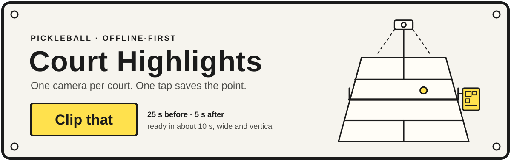
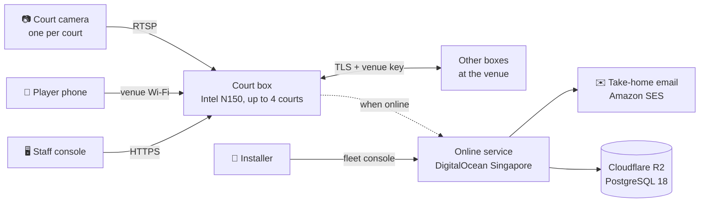

<p align="center">
  
</p>

<p align="center">
  <a href="https://github.com/hanai-dev/court-highlights/actions/workflows/ci.yml"></a>
  
  
  
  
  
</p>

<p align="center">
  <a href="#features">Features</a> ·
  <a href="#how-it-works">How it works</a> ·
  <a href="#quick-start">Quick start</a> ·
  <a href="#testing">Testing</a> ·
  <a href="#documentation">Documentation</a>
</p>

**Court Highlights** puts one camera on every court of a pickleball venue and a **Clip that** button on each court's
phone page. A small Intel N150 box records up to four courts and serves everything over the venue Wi-Fi: no app, no
player account, no internet needed. When the venue is online, an optional service emails players their videos and
gives the installer a fleet console.

> [!NOTE]
> Version 0.1.0 is built for the trial at Paddle Point Leisure Hub, Cagayan de Oro. It is not yet tagged or deployed;
> the [release notes](RELEASE_NOTES.md) list what is still open.

## Features

<table>
  <tr>
    <td width="50%" valign="top">
      <h3>🎬 Clip that</h3>
      One tap saves the 25 s before and 5 s after. Ready in about 10 s, in wide and vertical shapes.
    </td>
    <td width="50%" valign="top">
      <h3>🏓 Games</h3>
      Start and stop from any phone at the court. Get the whole game plus up to 5 highlights picked by the shot judge.
    </td>
  </tr>
  <tr>
    <td valign="top">
      <h3>📴 Works offline</h3>
      Court pages and downloads come straight from the box on the venue Wi-Fi. No sound is ever recorded.
    </td>
    <td valign="top">
      <h3>✉️ Take-home email</h3>
      When the venue is online: up to 8 addresses per game, one email each, links for about 3 days.
    </td>
  </tr>
  <tr>
    <td valign="top">
      <h3>🖥️ Staff console</h3>
      Courts today with box health, a clip library, footage holds and exports, an activity log and staff accounts.
    </td>
    <td valign="top">
      <h3>🔐 Several boxes, one venue</h3>
      Shared staff, settings and courts, with encrypted box-to-box sync and signed updates that roll back on failure.
    </td>
  </tr>
</table>

## How it works

<picture>
  <source media="(prefers-color-scheme: dark)" srcset="docs/readme/court-figure-dark.svg">
  
</picture>

1. **Scan the court code** on the sign at the net post, on the venue Wi-Fi.
2. **Tap Clip that** right after a good point. Tap again within 5 s to make it longer.
3. **Download** the clip, wide for watching or vertical for stories and reels.

Clips stay on the court page for 2 hours. Staff can keep a clip for up to a year.



| Part | Path | Stack | What it does |
|---|---|---|---|
| 📦 Court box | [`crates/box`](crates/box) | Rust, axum, GStreamer, SQLite | Recording, clips, games, shot judge, court pages, staff console, venue sync |
| 📐 Shared rules | [`crates/core`](crates/core) | Rust | Pure logic with golden tests: clip windows, expiry, send order, disk pressure, lockout |
| ☁️ Online service | [`crates/cloud`](crates/cloud) | Rust, axum, PostgreSQL 18, R2, SES | Box API, take-home email, fleet console |
| 🧪 End-to-end tests | [`tests/e2e`](tests/e2e) | Playwright | Runs against the compose stack with replayed footage as RTSP cameras |

## Quick start

You need [Docker](https://www.docker.com/) and [Node.js 24](https://nodejs.org/). Everything builds inside the
`ch-dev` image (Ubuntu 26.04, Rust 1.99, GStreamer 1.28).

**1. Build the image and both programs**

```sh
docker build -t ch-dev:0 -f docker/dev.Dockerfile docker
docker volume create ch-target && docker volume create ch-cargo-registry
docker compose -p ch-test -f docker/compose.test.yaml --profile build run --rm builder
```

**2. Start one box with replayed cameras and the online service**

```sh
docker compose -p ch-test -f docker/compose.test.yaml up -d rtsp cam-3 box-a db s3 ses cloud
```

**3. Open it**

| What | Address |
|---|---|
| Court pages | http://localhost:18080 |
| Staff console | https://localhost:18443/console |
| Online service and fleet console | http://localhost:18090 |

> [!TIP]
> To try a three-box venue, run
> `docker compose -p ch-test -f docker/compose.test.yaml --profile venue up -d venue-a venue-b venue-c`.
> The [runbook](RUNBOOK.md) covers stopping, health checks and configuration.

## Testing

```sh
cd tests/e2e
npm ci
npx playwright install --with-deps chromium webkit
npx playwright test
```

> [!IMPORTANT]
> The full end-to-end suite takes about an hour. CI runs it on pull requests and on demand.

<details>
<summary><b>Fast checks</b>, run on every push to <code>main</code> and every pull request</summary>

<br>

| Check | Tool |
|---|---|
| Format | `cargo fmt --check` |
| Lint | `cargo clippy -D warnings` |
| Unit and golden tests | `cargo test` |
| Licences | `tools/licence-check.cjs`, `tools/gst-licence-check.sh` |
| Advisories and leaked credentials | `tools/supply-chain-scan.sh` |
| Asset size budget, online running cost, support dates through 2030 | `tools/payload-check.cjs`, `tools/cost-model.cjs`, `tools/horizon-check.cjs` |

See [`.github/workflows/ci.yml`](.github/workflows/ci.yml).

</details>

## Documentation

| | Document | For |
|---|---|---|
| 📖 | [User guide](docs/user-manual.md) | Players, staff, the venue Owner, installers |
| 🛠️ | [Runbook](RUNBOOK.md) | Start and stop, health, configuration, backups, common problems |
| 📝 | [Release notes](RELEASE_NOTES.md) | What 0.1.0 does and what is still open |
| ⚖️ | [Known debt](DEBT.md) | Accepted findings and advisories, with when to look again |
| ✅ | [Requirements](docs/requirements/requirements.md) | What the product must do, with acceptance checks |
| 🏗️ | [Design](docs/HLD.md) | Architecture |
| 🎨 | [Visual design](DESIGN.md) | The "laminated sign" look of every page |
| 🧭 | [Tech stack decision](docs/adr/0001-tech-stack/stack-decision.md) | Why Rust on an Intel N-series box, and the options turned down |

<p align="center"><sub>Built for Philippine pickleball venues · Proprietary</sub></p>
