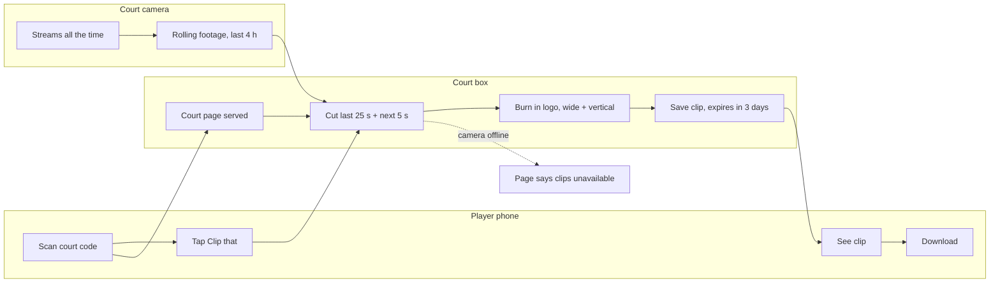

# Court camera highlights — client review

**Revision 19 · 2026-10-21 · FINAL — approved by the owner.** Final playback (understanding, scenarios, look, worked
examples, the 20 read-back items, out-of-scope list, operations and the technology decision) answered **"All 20
correct"** and **"Approve as final"**. Zero open items. The matching SRS is [requirements.md](requirements.md); later
changes go through `/forge:feature` and reopen only the affected items.

History note: earlier revisions said "every line below is a proposal or a question until you answer it" — every line
now carries the owner's recorded answer (State column) and the change log at the end shows when.

Companion: [domain-brief.md](domain-brief.md) (what similar products do + Philippine privacy rules, with sources).

## 1. What I think you want to build

**You said:** "an offline, Rust-based sports camera recording system that can be used for highlights, content creation,
etc. Like https://rallycam.ph/".

**What RallyCam does (from its site, 2026-10-20):** one ordinary network security camera per court. A small computer
on site keeps the last few hours of footage. Players scan a code on the net post and tap "Clip that" to keep the last
30 seconds, or tap record and stop to get a whole game. Every clip carries the club's logo and deletes itself after
three days unless saved. The video is processed on site, then *sent over the internet* to each player's address.

**You confirmed (rev 2):** you will **sell and install it at many venues**; it is **local-first** — everything works with
no internet, and when a venue has internet the box also sends finished clips out so players can get them at home;
**no sound** is recorded.

**I think** you want the same kind of system as RallyCam, but:

- it keeps working with **no internet at all**. Footage is recorded, cut and handed to phones inside the venue; when
  internet is there, finished clips (only) go out to a small online service you run.
- it is written in **Rust** and runs on a small computer at the venue (the "court box").
- it serves two jobs: **players keep their best moments**, and **the venue or a creator makes social content**.

**Main journey (proposal):** a player scans the court code and taps "Clip that" after a great rally. Within seconds the
last 30 seconds, with the venue logo, are on their phone through the venue Wi-Fi. They download it and post it.

**First release (proposal):** rolling recording on every court, one-tap clips, whole-game recording, download over
venue Wi-Fi, venue branding, a vertical version for TikTok/Reels, a staff console (cameras, courts, clip library,
staff accounts, settings), auto-delete, printed court signs.
*Rev 3 adds (your answers):* players add their **email address** on the court page and receive their clips and game
video by email once the box is online (A-79); **automatic highlights are a must-have in v1**, picture-only (A-21); your
online **fleet console** shows box health and pushes updates, never footage (A-81).
**Later / not in the first release (proposal):** live streaming, court booking, player payments, the camera following
the ball, linking clips to PB Passport profiles.

## 2. Two columns of goals

| The venue / you (business) | The players (daily users) |
|---|---|
| A reason to book these courts over the ones down the road | Get the shot on my phone before I leave the court |
| Free marketing: every shared clip carries the venue name | No app to install, no account to make |
| Nothing for the front desk to do | A format I can post straight away |
| No cloud fees; works on bad or no internet | Know when I'm being filmed; strangers can't watch my games |
| Stay out of privacy trouble | Get my clip deleted if I want |
| *(if you sell it)* steady income per court, cheap installs and support | |

**Conflicts flagged, not resolved:** a venue may want to keep good clips for months of marketing, while players and the
privacy rules push for short keeping (A-18, A-51). A venue wants clips shared widely, but other people in the frame did
not choose to be posted (A-10).

## 3. What needs your attention first

1. **Who is this for?** Many clubs that you sell to or install at, or one venue? (A-2)
2. **What does "offline" mean?** With no internet, a player can only get a clip while their phone is on the venue
   Wi-Fi. Once they leave, they can't reach it. Is that OK, or should clips go out when internet is available? (A-3)
3. **Sound — record it or not?** Sound makes clips better and auto-highlights easier. Recording people's conversations
   without consent is a crime under the Anti-Wiretapping Act, and the privacy regulator says CCTV should not record
   audio. (A-37)
4. **What box, and how many courts per box?** Adding the logo and making a vertical version need real video work.
   This decides the hardware cost per venue. (A-7, A-35)
5. **Which sports, and are automatic highlights in the first release?** (A-4, A-21)

## 4. Assumptions and unknowns (all areas)

State for every row: **open** (no one has answered yet). Basis: *You said* = your brief · *Recon* = what similar
products do (domain brief) · *Proposal* = my suggestion · *Missing* = a fact only you know.

### Purpose, scope & feasibility

| ID | What I heard, assume, or need to know | Why it matters if wrong | Basis | State | Links |
|---|---|---|---|---|---|
| A-1 | The goal: cameras at courts record all the time; players keep highlights; the venue gets branded content. | Everything else hangs on this. | You said + Recon S-01 | **default-confirmed** (rev 12) | all |
| A-2 | **You sell and install it at many venues** (like RallyCam). | Installer tools, updates across many boxes, support duty, and a written privacy agreement with each venue are now in play (A-14, A-54, A-67, A-68, A-82). | You said, rev 2 ("Many venues I sell/install") | **confirmed** | US-13, SC-4, SC-9 |
| A-3 | **Local-first.** Everything works with no internet (record, clip, download over venue Wi-Fi). When the venue has internet, the box also sends finished clips to an online service so players can open them at home. | Adds an online service you run and pay for, and finished clips leave the building (A-79, A-80, A-83). | You said, rev 2 ("Local + send when online") | **confirmed** | US-3, SC-3, SC-12 |
| A-4 | **Pickleball only** for v1. Other courts can still record and clip, but automatic highlights are only promised (and tested) for pickleball. | Selling to a padel or basketball venue in v1 means selling without automatic highlights. | You said, rev 4 ("Pickleball only") | **confirmed** | US-10 |
| A-5 | **v1 scope = everything confirmed in rev 2–12.** Out of v1: live streaming, court booking, player payments, ball-following camera, PB Passport link (A-42), clubhouse TV (A-29), sound (A-37), sports other than pickleball for highlights (A-4). | Sets cost and timeline. | Proposal; accepted rev 12 | **default-confirmed** (rev 12) | all |
| A-6 | **Hardware cost per court: the technology review prices 2–3 real box + camera options in pesos** against the 60-minute promise and venue size; you choose from real numbers. **No fixed deadline** — quality first; the shot judge's accuracy target (A-91) decides when the trial starts. The monthly running-cost ceiling for your online service is asked in the technology review (A-111). | Decides box and camera choice; no date pressure to trade accuracy away. | You said, rev 6 ("Let the review price it") + rev 13 ("No fixed date") | **confirmed** | — |
| A-7 | 1 camera per court. **Typical venue has more than 8 courts.** How the courts are split across boxes — A-98; the largest venue — A-99. | Sets the load: a 12-court venue playing back to back needs 12 hours of footage judged per hour (A-93). | You said, rev 6 ("More than 8") | **confirmed** (typical size) | SC-4 |
| A-8 | Success = in the first month at the trial venue, **at least half of started games produce at least one clip or highlight**, and the A-44 speed targets hold. | Without a measure we can't tell if it works. | Proposal | **default-confirmed** (rev 12) | SC-1 |

### People & access

| ID | What I heard, assume, or need to know | Why it matters if wrong | Basis | State | Links |
|---|---|---|---|---|---|
| A-9 | Players use **no app and no account**. They scan the court code and use a web page. | An account would add a step at the court; it would allow "my clips" across visits. | Recon S-01 + Proposal | **default-confirmed** (rev 9) | US-1..4 |
| A-10 | **Who can see a clip:** only people at that court page *during or shortly after* that game. A clip has a hard-to-guess link and the court page shows only that court's last 2 hours. Older clips are staff-only. Email links (A-79) keep working until expiry (A-18). | Without this, anyone on the venue Wi-Fi could browse other people's games. | Proposal; accepted rev 9 | **default-confirmed** (rev 9) | SC-1, SN-1 |
| A-11 | Staff roles: **Owner** (everything, including staff accounts and settings) and **Staff** (camera status, clip library, delete or keep clips, print signs). A "creator" can use Staff. | Too few roles leaks settings; too many is overhead. | Proposal | **default-confirmed** (rev 9) | US-6..8, US-12 |
| A-12 | Staff sign in with a username and password on the box. The Owner resets Staff passwords. A lost Owner password is reset with a **USB reset file** plugged into a box (physical access). Sessions end after 12 hours. | No email exists offline, so "forgot password by email" can't work. | Proposal | **default-confirmed** (rev 9) | SC-8 |
| A-13 | New staff: the Owner adds them. Staff leaving: the Owner deactivates them, which ends their open sessions at once. | An ex-staff member could keep access. | Proposal | **default-confirmed** (rev 9) | SC-8, SN-3 |
| A-14 | You (or your installers) set up and service many boxes. Boxes with internet can report health and take updates from you (A-81); boxes without it need a USB stick or a visit. | Support cost per venue. | Reopened rev 2 by A-2 + A-3 | **default-confirmed** (rev 11) | US-13, SC-9 |
| A-104 | **Your fleet console sign-in** (it is on the internet): password **plus a one-time code from an authenticator app**. Roles: **Admin** (you — everything, incl. a venue's online switch) and **Installer** (register new boxes, see health). | A stolen fleet password could switch off paying venues or push a bad update to every box. | Proposal (new rev 9); accepted rev 9 | **default-confirmed** (rev 9) | US-13, SC-9, SC-13 |

### Journeys & rules

| ID | What I heard, assume, or need to know | Why it matters if wrong | Basis | State | Links |
|---|---|---|---|---|---|
| A-15 | "Clip that" keeps **25 s before + 5 s after** the tap (30 s). The venue can set 10–60 s before and 0–15 s after. *Example:* tap at 7:40:30 pm → clip 7:40:05–7:40:35. | Too short cuts the rally; too long is boring to post. | Recon S-01 (30 s), S-02 (8–10 + 3–5); accepted rev 8 | **default-confirmed** (rev 8) | SC-1 |
| A-16 | Game video: "start" marks the beginning and "stop" the end. It stops on its own after **2 hours**. Only one game runs per court at a time. *Example:* started 6:02 pm → auto-stops 8:02 pm. | Forgotten stops would fill the disk; two groups might clash. | Proposal; accepted rev 8 | **default-confirmed** (rev 8) | SC-2 |
| A-17 | Rolling footage: the box keeps the **last 4 hours** per court and overwrites older footage. *Example:* at 9 pm, footage before 5 pm is gone unless it is in a clip, a game or a hold. | Longer = more disk and more privacy exposure; shorter = can't rescue a forgotten moment. | Recon S-01 ("last few hours"); accepted rev 8 | **default-confirmed** (rev 8) | SC-1, SC-7 |
| A-18 | Clips and game videos are deleted at the **first 3:00 am clean-up at least 72 hours after they were made**; the online copy and email link expire at the same moment. Clips staff mark **Keep** stay up to **1 year**, then delete. *Example:* made Mon 7:40 pm → deleted Fri 3:00 am; email says "available until Fri 3:00 am". | Venue marketing may want longer; privacy wants shorter. | Recon S-01 + Proposal; accepted rev 8 | **default-confirmed** (rev 8) | SC-5, SC-6 |
| A-19 | The venue logo is burned into every clip (corner, size set by the venue). An optional sponsor logo is allowed. | Clips spread the venue name, but logos can't be removed later. | Recon S-01/S-02 | **default-confirmed** (rev 8) | US-5 |
| A-20 | Each clip also comes as a **vertical 9:16** version, cut from the middle of the court (no ball-following in v1). | A fixed middle cut may lose players at the sides. | Recon S-02 + Proposal | **default-confirmed** (rev 8) | US-4 |
| A-21 | **Automatic highlights are a must-have in v1.** The box finds rallies by itself from the picture only (no sound, A-37). Details open in A-88..A-91. | Biggest single piece of v1 work and risk; needs a stronger box (A-35) and real court footage to tune and test on (A-90). | You said, rev 3 ("Must-have in v1") | **confirmed** | US-10, SC-10 |
| A-22 | A tap **5.0 s or less** after the previous tap joins the same clip, which then ends 5 s after the last tap. Taps further apart make separate clips, even if they overlap. *Examples:* taps at 7:40:30 and :35 → one clip 7:40:05–7:40:40; taps at :30 and :36 → two clips. | Prevents duplicates from excited multiple taps. | Proposal; accepted rev 8 | **default-confirmed** (rev 8) | SC-1 |
| A-23 | Fixing mistakes: a player can hide a clip they made from the court page. Staff can delete any clip. A deleted clip is gone (no bin). | A player may want a bad clip gone; staff need the final say. | Proposal | **default-confirmed** (rev 8) | SC-1, SC-7 |
| A-24 | Clips are **free to players**; the venue pays for the system. No payments in the app. | Paid clips would need payments, receipts and internet. | Proposal | **default-confirmed** (rev 12) | — |

### Experience & accessibility

| ID | What I heard, assume, or need to know | Why it matters if wrong | Basis | State | Links |
|---|---|---|---|---|---|
| A-25 | Players use their own phones (Android and iPhone) in the normal browser. Staff use a phone or laptop on the venue network. | An app would cost more and need app-store releases. | Proposal | **default-confirmed** (rev 12) | all |
| A-26 | **English only** for court pages, signs, emails and the staff console in v1. Words live in one place so a translation can be added later without rework. | Labels on court signs too. | You said, rev 12 ("English only") | **confirmed** | — |
| A-27 | Pages work with large text, a screen reader and a keyboard (WCAG 2.2 AA), and are readable in outdoor sun (high contrast). | Courts are bright and players are sweaty and in a hurry. | Proposal | **default-confirmed** (rev 12) | — |
| A-28 | **Look: D3 · Laminated sign** — off-white like the printed court sign, heavy black lines, one highlighter-yellow action colour, big plain type; same look on the phone court page and the staff console. Not chosen: D1 court-blue, D2 dark scoreboard, plain admin utility. No specific dislikes named. Mockups: [wireframes/index.html](wireframes/index.html). | Taste is easier to pick than to describe. | You said, rev 13 ("D3 · Laminated sign") | **confirmed** (direction, rev 13) · branding settled by A-110 (rev 14) | SC-1..SC-6 |
| A-107 | **Images:** real camera stills (clip thumbnails, setup preview); the **venue logo everywhere** — court page header, emails, court sign and clips; and a **welcome picture** on the first-run setup wizard and empty screens. *Picture (confirmed rev 18, "Line drawings"):* a black-line drawing in the D3 style — a pickleball court showing where the camera mounts (high, centre, 5–7 m) and the court sign on the net post for setup; a phone scanning the court code for the empty clip library. No other decorative art on task screens. | Orients installers and first-time staff; keeps task screens clear. | You said, rev 14 ("Logo everywhere", "Welcome picture in setup") + rev 18 ("Line drawings") | **confirmed** | SC-1, SC-4 |
| A-108 | **Saving feedback:** after a tap, an **animated ring fills over the 5 seconds after the tap** with "Saving… ready in 4 s", and the phone **vibrates once** where the phone allows it (most Android phones; iPhones' browsers don't allow it); then the clip appears. Under the phone's reduced-motion setting: no ring animation, text countdown only. | Players need to know the tap worked — mid-game, often without looking closely. | You said, rev 14 ("Livelier saving feedback") | **confirmed** | SC-1 |
| A-109 | **You supplied a venue logo: Paddle Point Leisure Hub, Cagayan de Oro** (navy paddle and wordmark, teal and green swoosh, in a circle). **Paddle Point is your first customer and the trial court; your test filming (A-90) happens there too.** Only a phone screenshot of the logo so far — the clips need the original logo file (PNG with a transparent background) before the trial. Its "Coming soon" post suggests it is not open yet: filming waits until its courts are playable. | Decides where we film (A-90), trial (A-43) and whose branding the first clips carry. | You said, rev 13 (logo) + rev 14 ("First customer + trial court") | **confirmed** · original logo file still needed | SC-4, A-43, A-90 |
| A-110 | **One fixed D3 look for every venue; the venue logo sits at the top of the court page** (and in emails, signs and clips, A-107). Venues don't change the page colours. | Always readable in sun; one look to test. | You said, rev 14 ("Logo on top, fixed look") | **confirmed** | SC-1 |
| A-112 | **Court page order:** venue logo + court name + recording status → **Clip that** → game panel (Start/Stop, timer, "venue may post") → **Send our videos to** emails → clips on this court. | The order of what players see first. | You said, rev 14 ("Right as shown") | **confirmed** | SC-1, SC-2, SC-3 |
| A-29 | A clubhouse TV that replays the latest clips — **later, not v1** (moved rev 12 to keep v1 focused on the shot judge). Revisit after the trial venue's first month. | Nice to have, extra screen to manage. | Recon S-02; accepted rev 12 | **default-confirmed** (rev 12) | — |

### Data & its lifetime

| ID | What I heard, assume, or need to know | Why it matters if wrong | Basis | State | Links |
|---|---|---|---|---|---|
| A-30 | The box stores rolling footage, clips, game videos, court and camera settings, staff accounts and an activity log. **Player email addresses** (A-79) are kept only until that game's videos are sent, then deleted from the box and the online service; no names or phone numbers. | Emails are personal data: notice, protection, deletion on request. | Proposal, changed rev 3 by A-79 | **default-confirmed** (rev 11) | SC-2, SC-3 |
| A-31 | Staff can download any clip or game as MP4. The activity log can be exported as a spreadsheet (CSV). | Bosses and privacy requests need copies. | Proposal | **default-confirmed** (rev 9) | SC-6, SC-7 |
| A-32 | No import from an old system (this is new). | — | Proposal | **default-confirmed** (rev 12) | — |
| A-33 | **512 GB disk per box (4 courts).** *Worked example at 4 Mbps 1080p (camera setting, to verify on the trial court):* rolling 4 h × 4 courts ≈ 29 GB; clips 50/court/day × 3 days × ~25 MB (wide + vertical) ≈ 15 GB; game videos ~6 h/court/day × 3 days × 1.8 GB/h ≈ 130 GB → **≈ 175 GB**, so 512 GB leaves ~3× headroom. The console warns at 80 % full; the rolling footage never shrinks below 4 h — the oldest unkept game videos are cleared first. | Too small a disk silently shortens the rolling footage. | Proposal; accepted rev 10 | **default-confirmed** (rev 10) | SC-5 |
| A-34 | The system **survives restarts and power cuts**: saved clips, settings and accounts are still there afterwards. | A venue loses power; a demo that resets is useless. | Forge default | **default-confirmed** (rev 9) | SC-9 |

### Connections & technical constraints

| ID | What I heard, assume, or need to know | Why it matters if wrong | Basis | State | Links |
|---|---|---|---|---|---|
| A-35 | The box is a **small Linux PC with a built-in video encoder and enough AI power to judge at least 4 hours of footage per hour** (A-93). Candidates: an NVIDIA Jetson-class board, a mini PC whose built-in graphics run the model, or a mini PC plus an add-on AI accelerator. Chosen on evidence and a timed test run in the technology review. **Rev 17: an Intel N150-class mini PC (e.g. Beelink EQ14, ~US$385) with Ubuntu 26.04 LTS, about ₱9,700 per court with a ~US$58 PoE camera; the build's speed test confirms it, Jetson Orin NX is the named backup (A-123).** | The 60-minute window (rev 5) lowers the bar from "live" to "4× real time", so a cheaper box may pass. | Proposal, updated rev 5 by A-93; box family from A-123 | **default-confirmed** (rev 10) · box family **confirmed** (rev 17) | A-7, A-6, A-95, A-123 |
| A-36 | Cameras: **ordinary network security cameras** (PoE, the standard RTSP/ONVIF stream, H.264), no brand lock-in, mounted high and central (5–7 m). | Locking to a brand raises cost; a bad mount ruins every clip. | Recon S-01/S-02/S-05 | **default-confirmed** (rev 10) | SC-4 |
| A-37 | **No sound is recorded or kept** — the box never asks the camera for its audio track. | Anti-Wiretapping Act and NPC camera rules (domain brief R-3, R-4). Clips are silent; automatic highlights must work from the picture only (A-21). | You said, rev 2 ("No sound") | **confirmed** | US-10 |
| A-38 | Trigger: phone court page first. A physical wireless button on the post is a *Could*. | A button is faster mid-game but costs hardware per court. | Recon S-02 + Proposal | **default-confirmed** (rev 10) | SC-1 |
| A-39 | The venue provides Wi-Fi players can join. The box does not make its own hotspot. | No player Wi-Fi = no delivery. | Proposal | **default-confirmed** (rev 10) | SC-3 |
| A-40 | **Rust end to end** (box and online), decided by you (A-113) and confirmed by the technology review: see A-123 and [stack/stack-decision.md](stack/stack-decision.md). | You asked for Rust. Maintenance follows the choice. | You said + review rev 17 | **confirmed** | A-123 |
| A-41 | Any automatic-highlight model only *suggests* clips and never deletes or hides anything. The Owner can switch it off **per venue**. | A wrong suggestion should cost nothing. | Proposal; accepted rev 10 | **default-confirmed** (rev 10) | SC-10 |
| A-42 | Linking clips to **PB Passport** player profiles: not in v1 (needs internet and accounts). | Possible later tie-in with your other product. | Proposal (memory: you run PB Passport) | **default-confirmed** (rev 12) | — |

### Testing & acceptance

| ID | What I heard, assume, or need to know | Why it matters if wrong | Basis | State | Links |
|---|---|---|---|---|---|
| A-43 | Tested on a bench with **recorded court footage played back as fake cameras**, then a **two-week trial on one real court**. | Lab tests miss glare, Wi-Fi dead spots and real player behaviour. | Recon S-01 (fortnight trial) + Proposal | **default-confirmed** (rev 12) | all |
| A-44 | Targets, **with each box recording all 4 of its courts**: clip ready on the phone within **10 s** of the end of its window for 95 of 100 taps; **no recording gap longer than 2 s** per court in 24 hours; highlight reel within **60 min** of Stop under the 12-court load (A-93, A-99). | Numbers make "fast" and "reliable" checkable. | Proposal | **default-confirmed** (rev 12) | SC-1 |
| A-45 | **You sign off each story by walking its scenario on the trial court.** | Someone must say "done". | You said, rev 13 ("Me, on the trial court") | **confirmed** | all SC |

### Environments & deployment

| ID | What I heard, assume, or need to know | Why it matters if wrong | Basis | State | Links |
|---|---|---|---|---|---|
| A-46 | Install from a prepared USB stick/image. A first-run setup wizard runs on the box. | Each venue install must be repeatable. | Proposal | **default-confirmed** (rev 12) | SC-4 |
| A-47 | Updates come as a file (USB stick, or a download in the console when internet happens to be there). If the new version fails its health check, the box goes back to the old one by itself. Boxes at one venue update **one at a time**, so a bad update never takes down every court. | A bad update with no internet means a site visit. | Proposal | **default-confirmed** (rev 12) | SC-9 |
| A-48 | Three places: your laptop (fake cameras), a test bench box, the live venue box. | Never test on a live venue. | Proposal | **default-confirmed** (rev 12) | — |

### Security & misuse

| ID | What I heard, assume, or need to know | Why it matters if wrong | Basis | State | Links |
|---|---|---|---|---|---|
| A-49 | The staff console needs a sign-in. **5 wrong passwords lock that account for 15 minutes** on every box at the venue. Player pages can never change settings. | Anyone on the venue Wi-Fi can reach the box. | Proposal | **default-confirmed** (rev 9) | SN-2 |
| A-50 | Footage on the box is **encrypted on disk**, so a stolen box doesn't hand over members' videos. | Boxes sit in cupboards. | Proposal (older NPC advisory required encryption — to verify) | **default-confirmed** (rev 9) | SN-5 |
| A-51 | Activity log of who kept, deleted, exported clips and changed settings. | Disputes and privacy requests need it. | Proposal | **default-confirmed** (rev 9) | SC-7 |
| A-52 | The only upload is the venue logo: PNG or JPEG, up to 2 MB, checked. | A harmful file could break the box. | Proposal | **default-confirmed** (rev 9) | SN-4 |

### Privacy & compliance (Philippines — applicability open until reviewed)

| ID | What I heard, assume, or need to know | Why it matters if wrong | Basis | State | Links |
|---|---|---|---|---|---|
| A-53 | The box prints a **court sign** with the code, "this court is recorded", what for, how long it's kept and who to contact. | Privacy rules expect notice before recording. | Recon S-08 (§3) | **default-confirmed** (rev 11) | SC-4 |
| A-54 | The **venue** is responsible for the footage (personal information controller). Because you sell the system and your online service holds sent clips, **you are their processor** and need a written agreement with each venue. Forge drafts a template; the reviewer (A-59) finalises it. | Decides who answers complaints and the regulator. | Recon S-10 + A-2/A-3 confirmed rev 2; accepted rev 11 — legal applicability still needs the reviewer (A-59) | **default-confirmed** (rev 11) | SC-7 |
| A-55 | No music is added to clips (copyright). | Posts with unlicensed music get taken down. | Proposal | **default-confirmed** (rev 11) | — |
| A-56 | Recording runs **only during opening hours** set by the venue, not 24/7. | 24/7 recording of an empty or after-hours court is hard to justify. | Proposal (RallyCam says 24/7) | **default-confirmed** (rev 8) | SC-5 |
| A-57 | Footage requests (an incident, a parent): staff find footage by court and time, put a **hold** on it so it isn't overwritten or expired (a hold lasts until released, **at most 60 days**), export a copy and log it. If it's already gone, they record "footage no longer exists". | Privacy rules require keeping footage while a request is pending. | Recon S-08 (§6) | **default-confirmed** (rev 11) | SC-7 |
| A-58 | Children on court: the email box and the Start tick box say **"Under 18? Ask a parent first."** Whether more is required is for the reviewer (A-59). | Unknown legal duty. | Proposal; accepted rev 11 — reviewer to confirm | **default-confirmed** (rev 11) | SC-2, SC-7 |
| A-59 | **Legal review is a launch gate, not a build gate.** Building may proceed; **no venue goes live (paid or trial with members) until a named reviewer has signed off** the privacy and legal points: CCTV circular, wiretapping, email collection, children, processing agreement. Who that reviewer is: **not decided yet** — must be named before the first venue goes live. Forge prepares the question pack. | Forge cannot certify compliance; selling before review risks NPC complaints and RA 4200 exposure. | You said, rev 11 ("Not decided yet") | **confirmed** (as launch gate) · reviewer not yet named | all |

### Reliability & recovery

| ID | What I heard, assume, or need to know | Why it matters if wrong | Basis | State | Links |
|---|---|---|---|---|---|
| A-60 | Power cut: recording restarts by itself when power returns. Saved clips stay. Footage during the outage is lost. A small UPS is recommended. | Players will ask why their game is missing. | Proposal | **default-confirmed** (rev 11) | SC-9 |
| A-61 | Camera unplugged: the console shows that court in red, and the court page says "camera offline — clips not available". | Silent failures = angry players. | Proposal | **default-confirmed** (rev 11) | SC-5 |
| A-62 | Box dies: footage and clips are lost (they're short-lived anyway). Settings, courts, logo and accounts come back **from the other boxes at the venue** (A-103), or from a **settings backup file** made in the console when it was the only box. | Rebuilding a venue by hand takes hours. | Proposal; accepted rev 11 | **default-confirmed** (rev 11) | SC-9, SC-14 |
| A-63 | **One disk per box.** If it dies, that box's rolling footage and unsent clips are lost; clips already sent survive online and settings return from sibling boxes (A-62). | Mirrored disks would add cost per box. | You said, rev 13 ("Single disk is fine") | **confirmed** | SC-9 |
| A-64 | The box keeps correct time without internet (it has a clock battery, and staff can correct the time in the console). | Wrong time = can't find footage for a request. | Proposal | **default-confirmed** (rev 10) | SC-7 |

### Monitoring & support

| ID | What I heard, assume, or need to know | Why it matters if wrong | Basis | State | Links |
|---|---|---|---|---|---|
| A-65 | A health page shows per court: recording yes/no, camera reachable, last clip time; and per box: free disk, temperature, version. Online boxes also report these numbers to your fleet console (A-81); offline boxes show them only locally. | Someone must notice failures. | Proposal; accepted rev 11 | **default-confirmed** (rev 11) | SC-5, SC-14 |
| A-66 | Logs on the box never contain player data. | Logs leak too. | Proposal | **default-confirmed** (rev 9) | — |
| A-67 | **You (or your team) answer venue calls 7 days a week during venue opening hours (about 6 am–11 pm).** The staff guide and the console's Help page show your support number. | Support cost and promise; a fleet alert at 7 am must reach someone who is awake. | You said, rev 11 ("Me, during opening hours") | **confirmed** | SC-9, SC-14 |

### Maintenance & handover

| ID | What I heard, assume, or need to know | Why it matters if wrong | Basis | State | Links |
|---|---|---|---|---|---|
| A-68 | **Venues buy the boxes and cameras**; you own the software and charge for the online service (A-82). The venue controls its footage (A-54). On exit the venue keeps its hardware, wiped (A-70). | Contracts, resale, and what "leaving" means. | You said, rev 12 ("Venue buys them") | **confirmed** | SC-11 |
| A-69 | Guides: installer guide, one-page staff guide, printable court sign. | Without them every install needs you. | Proposal | **default-confirmed** (rev 12) | SC-4 |

### Retirement & exit

| ID | What I heard, assume, or need to know | Why it matters if wrong | Basis | State | Links |
|---|---|---|---|---|---|
| A-70 | Closing a venue or reselling a box: **"Wipe box"** (Owner only, type the venue name to confirm) erases all footage, clips, accounts and logs after an optional settings export, and removes the box from your fleet console. | Old member footage must not leave on a resold box. | Proposal | **default-confirmed** (rev 12) | SC-11 |

### New in rev 2 — the online part (from A-2 + A-3)

| ID | What I heard, assume, or need to know | Why it matters if wrong | Basis | State | Links |
|---|---|---|---|---|---|
| A-79 | **Players get clips at home by email.** On the court page a player types their email address; the clip or game video arrives as an email with a link to watch and download it once the box is online. | Collects personal data (A-30, A-85), needs an email-sending service (A-87) and abuse limits (A-86). | You said, rev 3 ("Email address") | **confirmed** | US-3, SC-2, SC-3, SC-12 |
| A-80 | The online service keeps sent clips until the **same expiry moment** as the box (A-18), then deletes them. It runs in a single region near the Philippines (e.g. Singapore). The email link says when it expires. | Running cost grows with how long clips are kept online. | Proposal | **default-confirmed** (rev 9) | SC-12 |
| A-81 | **Your fleet console** (online, for you only): every venue's box health, last check-in, version, and pushing updates. It **cannot** watch footage or clips. | Without it, every fault is found by the venue calling you. | You said, rev 3 ("Health + updates") | **confirmed** | US-13, SC-9 |
| A-82 | **When a venue stops paying, its online features stop:** you switch the venue off in the fleet console → its emails and updates stop; recording, clips and on-court download keep working. **Billing stays outside the system** (your own invoices); the system only has the on/off switch and a log of who flipped it. | No licence lock to build or to misfire on a venue with bad internet. Players at an unpaid venue stop getting emails — the court page must say so (A-100). | You said, rev 6 ("Online features stop") | **confirmed** | US-13, SC-13 |
| A-83 | **Only finished clips and health numbers leave the building.** Rolling footage and whole game videos never do. Clips that a player hid or staff deleted are deleted online too. | Keeps the privacy story simple: "your games stay at the club". | Proposal | **default-confirmed** (rev 9) | SC-12, SC-7 |

### New in rev 3 — email delivery and automatic highlights

| ID | What I heard, assume, or need to know | Why it matters if wrong | Basis | State | Links |
|---|---|---|---|---|---|
| A-84 | **The game is the unit for email** (RallyCam's way). While a game is recording on a court, anyone on that court page can add their email ("send our videos to…"). Everyone on the list gets the game video, every clip tapped during the game, and that game's automatic highlights. A clip tapped with no game running has its own "email me this" box. | Keeps it to one address entry per player per game. | Recon S-01 + Proposal | **default-confirmed** (rev 9) | SC-2, SC-3 |
| A-85 | Next to the email box: one line saying the address is used only to send these videos and is deleted after sending; a link to the venue's privacy notice. | Collecting emails without notice breaks the privacy rules. | Proposal (domain brief R-1) | **default-confirmed** (rev 9) | SC-2 |
| A-86 | Abuse limits: at most **8 addresses per game**; a player can remove a mistyped address until the videos are sent; every email has "this isn't me — don't email me again", which blocks that address for all your venues. | Someone could send strangers' game videos to random people or use the box to spam. | Proposal | **default-confirmed** (rev 9) | SN-6 |
| A-87 | Emails are sent by your online service through a transactional email provider (chosen in the technology review), from an address on your domain. Box only queues; it never sends email itself. | Deliverability (spam folders) and monthly cost. | Proposal | **default-confirmed** (rev 9) | SC-12 |
| A-88 | **The reel is the game's best shots, judged by the box** from the picture (ball and players), up to 5, best first. Each highlight shows the whole point that contains the shot, trimmed to at most 20 s and ending 2 s after the point ends. Which moments count as "best" — A-92. | The hardest feature in v1: the box must follow a small fast ball and the players. A wrong pick costs little (players ignore it, A-41). A missed great shot disappoints, but the game video and taps are still there. | You said, rev 4 ("Best shots judged by box"); trimming = Proposal | **confirmed** (rev 4–6) · details **default-confirmed** (rev 10) | SC-10 |
| A-89 | **Automatic highlights only for games players started** (opt-in). The box does not cut highlights from courts where nobody started a game. | Cutting clips of people who never asked is a privacy problem (A-56). | You said, rev 5 ("Only started games") | **confirmed** | SC-10 |
| A-90 | **You film the test footage at a partner court**: about 10 hours of real games from the planned camera position, a mix of skill levels and day/night light, with every player's written consent. Forge drafts the filming checklist, consent form and marking sheet. | Without it nobody can tune or prove the shot judge. | You said, rev 4 ("I'll film at a partner court"); size + kit = Proposal | **confirmed** (rev 4–6) · details **default-confirmed** (rev 10) | SC-10, A-93 |
| A-91 | **How we check the shot judge:** two or three people who know pickleball independently mark the highlight-worthy moments in the test footage. Pass = in at least **8 of 10 test games**, at least **3 of the box's top 5** are moments the markers picked, and **none** of the 5 is dead time (walking, ball pick-up). Reel-ready time — A-93. | "Best" is taste; agreement with knowledgeable people is the only checkable stand-in. | Proposal, changed rev 4 by A-88 | **default-confirmed** (rev 10) | SC-10 |
| A-92 | **"Best" means all four kinds:** long rallies, fast hand battles at the kitchen line, put-aways and smashes, and the rare spectacular shots (around-the-post, Erne, diving or lunging gets). | The box is built and tested to find these four; anything else (e.g. lob winners) is not promised. | You said, rev 5 | **confirmed** | SC-10 |
| A-93 | **Reel ready within 60 minutes of Stop**, even when every court stops at once. Players mostly get it by email (A-79); the court page shows "Highlights coming — about N min". **Load model:** a 4-court venue with games back to back all evening → the box must judge at least 4 hours of footage per hour, sustained. | Cheapest box that meets the promise; players who leave quickly see the reel at home, not on court. | You said, rev 5 ("Within 60 minutes"); load model = Proposal | **confirmed** (rev 4–6) · details **default-confirmed** (rev 10) | SC-10, A-35 |
| A-98 | **Several identical small boxes per venue, about 4 courts each, with one venue console over all of them.** A 12-court venue has 3 boxes. A box fault stops only its own courts; you stock one box type and swap it. | More software: boxes must find each other and share staff accounts and settings (A-102, A-103). | You said, rev 7 ("Several small boxes") | **confirmed** | SC-4, SC-9, SC-14 |
| A-99 | **Largest venue: 12 courts** (3 boxes). Load model for every test: 12 courts recording, games back to back, each box judging its 4 courts' footage within the 60-minute promise. | Anything bigger is outside v1's tested size. | You said, rev 7 ("Up to 12") | **confirmed** | A-93 |
| A-101 | **Players agree at Start before the venue may post their highlights.** The Start screen has a tick box "The venue may post our highlights on its pages", **off by default**. The clip library marks clips the venue may post; downloading any other clip "for posting" shows a warning first. | Supports the content-creation goal without posting people who never agreed. Only the group starting the game ticks it — others in the frame (A-10) are not asked. | You said, rev 7 ("Ask at Start") | **confirmed** | SC-2, SC-6 |
| A-102 | **Every box can show the whole venue console.** Each box keeps its own courts' footage and clips; the console asks the other boxes over the venue network. If a box is down, its courts show "box unreachable" and the rest work normally. | No single "main" box whose failure blinds the venue. | Proposal | **default-confirmed** (rev 10) | SC-14 |
| A-103 | Staff accounts, venue settings (logo, hours, clip length, expiry) and the "online features" switch are **the same on every box at a venue**; a change on one box reaches the others within a minute, or as soon as an unreachable box returns. | Otherwise a deactivated staff member could still sign in on another box. | Proposal | **default-confirmed** (rev 10) | SC-8, SC-14 |
| A-100 | At a venue switched off (A-82), the court page hides the email box and says "Download your videos here — email isn't available at this venue". | Players shouldn't type emails that will never be sent. | Proposal | **default-confirmed** (rev 9) | SC-13 |
| A-105 | **What goes online for email:** clips and highlights at full 1080p; the **whole-game video at 720p** (≈ 0.7 GB per hour). Upload speed is capped by a setting the installer picks per venue; clips and highlights go before game videos. Full-quality game video stays downloadable on court. *Example:* 12 courts × 6 game-hours each with emails ≈ 50 GB/day online; at a 20 Mbps cap that is ≈ 5.6 hours of sending. | A 12-court venue sending full-quality games (~130 GB/day) would choke a normal broadband line and raise your storage bill. | You said, rev 10 ("Game video at 720p") | **confirmed** | SC-12 |
| A-96 | **Rare shots are best-effort in v1.** Long rallies, hand battles and put-aways each have their own pass mark (A-91). Around-the-post, Erne and diving gets are only scored if the test footage holds at least 10 of each; otherwise they're reported but don't fail v1. | Rare shots have too few examples to learn from or to test fairly; making them a hard gate could block v1 indefinitely. | Proposal | **default-confirmed** (rev 10) | A-91 |
| A-97 | Highlights carry **no shot-type label** in v1 (no "SMASH!" caption) — the reel is ranked, not captioned. | A wrong caption is more embarrassing than a dull pick. | Proposal | **default-confirmed** (rev 10) | SC-10 |
| A-94 | **Training footage is separate from test footage.** Teaching the box to see a pickleball needs many hand-marked frames — from public pickleball datasets where the licence allows, plus extra partner-court footage. Test footage is never used for training. | Testing on training footage gives a false pass. | Proposal | **default-confirmed** (rev 10) | A-90 |
| A-95 | The shot judge runs **after Stop** (not live), on a lower-resolution copy of the picture, one game at a time per court. | Keeps the hardware smaller than live judging. | Proposal | **default-confirmed** (rev 10) | A-35, A-93 |

### Technology review inputs (rev 15)

| ID | What I heard, assume, or need to know | Why it matters if wrong | Basis | State | Links |
|---|---|---|---|---|---|
| A-113 | **Rust is decided** (owner mandate) for the box software. The review still researches alternatives and shows what Rust costs; the record is owner-mandated. | Rust is fixed; alternatives are shown for honesty, not re-litigated. | You said, rev 15 ("Decided (mandate)") | **confirmed** | A-40 |
| A-114 | **Licence rule: keep the box code private** — no GPL/AGPL building blocks that would force publishing the box software; LGPL only where kept separate (dynamically linked or a separate program). Applies to AI models too (e.g. AGPL-licensed detectors are out). | Rules out some popular video encoders and AI model families. | You said, rev 15 ("Keep my code private") | **confirmed** | A-40 |
| A-115 | **You alone maintain it** after the build (with Forge/Claude); you know Rust, TypeScript/Next.js and Go. | One person = fewer runtimes and moving parts win. | You said, rev 15 ("Me alone") | **confirmed** | A-67 |
| A-116 | **Support horizon: 3 years** from first release. For the "still supported" check we use **2030-06-30** (first release assumed by mid-2027; revisit if later). | Every OS, runtime and AI runtime must stay patched until then. | You said, rev 15 ("3 years"); end date = Proposal | **confirmed** (rev 15–16) | A-47 |
| A-117 | **Usage model:** ~**10 venues** by end of year 1, ~**50 by year 3** (~10 courts and ~3 boxes each → ~100 courts / ~30 boxes, then ~500 / ~150). Online, *upper bound* per court per day: 6 game-hours with emails at 720p + clips ≈ 5.5 GB sent, 48 emails. Year 1 upper bound: ≈ 550 GB/day sent, ≈ 1.65 TB held for 72 h, ≈ 144,000 emails/month; expected about one-third of that. Region Singapore (A-80). | Sizes the online bill and the storage choice (download fees matter: players download games). | You said, rev 15 (growth); load figures = Proposal from A-33/A-105 | **confirmed** (rev 15–16) | A-105, A-80 |
| A-118 | **Online budget: US$25–100 a month** at the year-1 size (storage, email, fleet console hosting). | Knocks out setups that charge for downloads at this volume. | You said, rev 15 | **confirmed** | A-80, A-87 |
| A-119 | **Hosting: reuse DigitalOcean (Singapore) + Cloudflare**, in a new, separate project for this product. | Same providers you already run. | You said, rev 15 ("Reuse DO + Cloudflare") | **confirmed** | A-80 |
| A-120 | **Decision drivers and weights locked** as in [stack/drivers-draft.md](stack/drivers-draft.md): H (3) = RQ-1 recording continuity, RQ-2 clip turnaround, RQ-3 shot-judge throughput, RQ-4 one-person upkeep; M (2) = RQ-5 hardware cost, RQ-6 support horizon, RQ-7 online cost, RQ-8 safe updates, RQ-9 reuse, RQ-10 cameras, RQ-11 security; L (1) = RQ-12 harness record, RQ-13 exit path. Locked before scoring. | Weights steer the result; locking them first prevents tuning them to a favourite. | You said, rev 16 ("Lock as shown") | **confirmed** | — |
| A-121 | **Web pages (court page, staff console, fleet console) are rendered by the Rust server itself** — one language end to end, no separate Node.js. | One language is less to maintain alone (A-115). | You said, rev 16 ("Rust server renders them") | **confirmed** | A-40 |
| A-122 | **Smaller, easy-to-change choices approved as a group:** server-built askama pages + a little plain JavaScript (saving ring, vibration); `cargo test` + Playwright for tests; clippy + rustfmt; Amazon SES for email; Cloudflare R2 for clip storage; systemd-sysupdate (or RAUC, decided by the speed test) for box updates. | Each can be swapped later without a rewrite. | You said, rev 17 ("Approve all") | **confirmed** | A-87, A-80, A-47 |
| A-123 | **Technology decision — O-2: Rust on an Intel N150-class mini PC (Ubuntu 26.04 LTS)**, with tokio/axum, retina (camera reader, GStreamer fallback), GStreamer 1.28 Intel hardware encoding, ort + OpenVINO for the shot judge, SQLite on the box; online Rust axum + PostgreSQL 18 + Cloudflare R2 + Amazon SES on DigitalOcean Singapore. **Intel first; Jetson Orin NX is the backup** if the speed test fails (with its price and May-2029 support gap shown to you then). Accepted downsides: AI connector still a release candidate, pre-1.0 web framework, narrower camera reader, unproven shot-judge speed until the spike. Record: [stack/stack-decision.md](stack/stack-decision.md), gate `STACK_DECISION: READY`, ledger:27b558b5dfd0f5e7. | The build's biggest one-way door; reopens if the speed test misses, a driver changes, or a candidate is added. | You said, rev 17 ("Intel first, Jetson as backup") on top of A-113 | **confirmed** (owner-mandated, research agrees) | A-35, A-40, A-6 |

### New in rev 18 — staff connection and derived details

| ID | What I heard, assume, or need to know | Why it matters if wrong | Basis | State | Links |
|---|---|---|---|---|---|
| A-124 | **The staff console is encrypted with the box's own certificate.** Each staff device shows a one-time browser warning the first time; the staff guide shows the box's fingerprint to check. Player pages stay plain (no passwords on them). | Without it, staff passwords cross the venue Wi-Fi readable by anyone on it. | You said, rev 18 ("Box's own certificate") | **confirmed** | SC-8, SN-2 |
| A-125 | **Derived details accepted as a batch:** court page ≤ 2 s on venue Wi-Fi with 100 phones; a first-time player saves a clip ≤ 60 s without help; hard-bounced addresses never emailed again; per-box secret keys issued at registration and revocable; a venue key lets boxes trust each other; fleet health kept 90 days and fleet actions logged; venue privacy notice from a Forge template, finalised by the reviewer. | Each becomes a requirement and a test. | You said, rev 18 ("Accept all") | **default-confirmed** (rev 18) | SC-3, SC-4, SC-14 |

### Final sign-off (rev 19)

| ID | What I heard, assume, or need to know | Why it matters if wrong | Basis | State | Links |
|---|---|---|---|---|---|
| A-126 | **Read-back items confirmed one by one:** (1) logo burned into every clip, highlight and game video; (2) wide + vertical versions; (3) footage holds ≤ 60 days with export and log; (4) court-sign notice text; (5) venue = controller, you = processor with a written agreement; (6) red court within 10 s of a camera drop; (7) games stop at closing time; (8) lockout counts consecutive failures, a success resets; (9) temporary staff password expires after 72 h unused; (10) Keep's 1 year counts from pressing Keep; (11) disk clean-up from 90 % down to 85 %, never touching the 4 h of footage; (12) box flagged after 5 min without check-in; (13) recording resumes ≤ 60 s after start-up; (14) clip near the start of recording cut to existing footage; (15) a long point keeps its last 20 s; (16) 7:1 text contrast; (17) failed update rolls back ≤ 10 min; (18) install ≤ 30 min per box; (19) staff passwords ≥ 12 characters; (20) no second sign-in factor on the venue staff console. | These became exact requirements and tests in the SRS. | You said, rev 19 ("All 20 correct") | **confirmed** | SRS §12.2 |
| A-127 | **Final approval** of client-review revision 19 and the matching requirements.md. | Locks scope for the build. | You said, rev 19 ("Approve as final") | **confirmed** | all |

### Things people assume without saying (must-be checklist)

| ID | Item | Proposal | State |
|---|---|---|---|
| A-71 | Sign-in, password reset, session expiry | Staff only — A-12 (players have no accounts, A-9) | **confirmed** via A-12 (rev 9) and final approval (rev 19) |
| A-72 | Search / filter on every list | Clip library filter by court, date, kept/not kept, "venue may post" (A-101), across all the venue's boxes; staff list | **default-confirmed** (rev 9) |
| A-73 | Lists with many items | Clip library pages of 50; a busy 12-court venue makes roughly 600 clips a day (estimate: ~50 per court per day incl. highlights), to check on the trial court | **default-confirmed** (rev 9) |
| A-74 | Receipts where money moves | Not applicable while clips are free (A-24) | **not-applicable** — no payments in the system (A-24 rev 12, A-82 rev 6); approved rev 19 |
| A-75 | Onboarding / empty states | First-run wizard (owner password → venue name and logo → find cameras → name courts → print signs). Empty clip library says how to make the first clip. | **default-confirmed** (rev 9) |
| A-76 | Time zone, date format | Asia/Manila, 12-hour time on player pages | **default-confirmed** (rev 9) |
| A-77 | Management of every item (create / edit / delete) | Courts, cameras, staff accounts, clips, logo, opening hours | **default-confirmed** (rev 9) |
| A-78 | Settings | Venue settings (name, logo, hours, clip length) + my-account settings (change password). *Rev 19.1: expiry is **not** a venue setting — fixed 72 h everywhere (A-18).* | **default-confirmed** (rev 9) · expiry correction **confirmed** (rev 19.1, "Fixed 72 h everywhere") |

Already covered elsewhere: correction paths (A-23), export (A-31), audit trail (A-51), backup and restore (A-62), data
import (A-32), offline (A-3), new hire / someone quit (A-13).

## 5. User stories

*Owner review rev 13: the stories and scenarios as replayed in rev 12 are "accurate as written".*

- **US-1** — As a **player**, I want to save the last half-minute with one tap, so that I keep a great rally I never
  planned to record.
- **US-2** — As a **player**, I want to record our whole game, so that we can watch it back or cut our own highlights.
- **US-3** — As a **player**, I want the clip on my phone without an app or account, even if the venue has no internet.
- **US-4** — As a **player**, I want a share-ready vertical version, so that I can post it straight to TikTok or Reels.
- **US-5** — As the **venue owner**, I want my logo on every clip, so that every share advertises my courts.
- **US-6** — As the **venue owner**, I want to set up courts and cameras and print court signs myself, so that I don't
  need a technician for small changes.
- **US-7** — As **venue staff**, I want to see at a glance that every court is recording, so that players are never
  let down.
- **US-8** — As a **venue content creator**, I want to browse clips across courts and export the best, so that I can
  post them on the venue's pages.
- **US-9** — As the **venue owner**, I want clips to delete themselves after a few days, so that we don't hoard members'
  videos.
- **US-10** — As a **player**, I want highlights found for me, so that I don't have to remember to tap. *(Could)*
- **US-11** — As the **venue owner**, I want to answer a footage or deletion request properly, so that we follow the
  privacy rules.
- **US-12** — As the **venue owner**, I want to add and remove staff, so that only current staff can reach the console.
- **US-13** — As **you, the seller/installer** *(only if A-2 = many venues)*, I want to install and update boxes
  quickly, so that each venue costs little to run.

## 6. Scenarios (drafts — numbers and names are invented examples)

**SC-1 — Clip a great rally** (US-1, US-3; A-9, A-10, A-15, A-22, A-44). Mia is playing on Court 2 at 7:40 pm. Her
phone is on the venue Wi-Fi.
1. Before the game, Mia scans the court code on the net post → her browser opens the Court 2 page with a big
   **Clip that** button. No sign-in.
2. After a 20-shot rally she taps **Clip that** → the page shows "Saving…", and the box cuts 25 s before + 5 s after
   from Court 2's rolling footage.
3. About 5 seconds after the clip window ends, the clip with the venue logo appears at the top of the page, in wide and
   vertical versions.
4. Mia taps **Download** → the MP4 goes to her phone's photos or files.
- *Excited triple tap:* one clip (A-22).
- *Camera offline:* the page says "Court 2 camera is offline — clips aren't available"; nothing is saved.
- *Phone not on venue Wi-Fi:* the code's page doesn't load; the sign says "join the venue Wi-Fi first".
- *Wrong court:* Mia scanned Court 3 by mistake → she gets Court 3's clip; she can hide it (A-23).
- *Two hours later at home:* the clip is unreachable (offline delivery, A-3) — open question.

**SC-2 — Record our whole game** (US-2; A-16). Four friends on Court 1.
1. One taps **Start game** → "Recording since 6:02 pm" shows on every phone on that court page.
2. They play. They can still tap **Clip that** during the game.
3. They tap **Stop** → the box cuts 6:02–6:58 pm with the logo; "Game video ready" appears in a few minutes (length
   depends on the box — target set in the numbers round).
4. Each friend downloads it.
- *Forgot to stop:* it stops at 2 hours.
- *Another group taps Start while a game runs:* they see "A game is recording since 6:02 pm — stop it?"
- *Power cut mid-game:* the part before the cut is saved as a game video; recording resumes when power returns.

**SC-3 — Take it home and post it** (US-3, US-4; A-79, A-84..A-86). *Changed rev 3.* Mia's group started a game on
Court 2. On the court page each of them types an email under **Send our videos to** (Mia types hers, Ben mistypes his and
fixes it with the ✕). They play, Mia taps **Clip that** twice, then they tap **Stop**. Within minutes (venue online),
each gets one email: "Your game at <Venue>, Court 2, 6:02–6:58 pm" with links to the game video, Mia's 2 clips and the
automatic highlight reel, each with Download. Mia saves the vertical clip and posts it.
- *Venue has no internet today:* the page says "Emails will go out when the club is back online"; downloading on
  court still works.
- *Link opened after 3 days:* "These videos have expired."
- *Address typed wrong and already sent:* can't be recalled; the wrong recipient can use "this isn't me".

**SC-12 — The box sends videos when internet is back** (A-3, A-79, A-80, A-83, A-87). *Changed rev 3.* The venue's
internet drops at 5 pm. Players keep clipping and downloading on court as normal. At 8 pm the line returns → the box
sends the waiting videos (oldest game first) to your online service without slowing recording → the service emails each
address → the box and service delete the addresses. A clip hidden or deleted before it was sent is never sent.

**SC-4 — Set up a new venue** (US-6, US-13; A-7, A-36, A-46, A-53, A-75).
1. The installer mounts one camera per court, plugs them and the box into the network switch, and switches on.
2. The owner opens the box's address on a laptop → the setup wizard asks for an owner password, venue name, logo and
   opening hours.
3. The wizard lists cameras found on the network → the owner names each one (Court 1…4) and sees a live preview.
4. The owner prints the court signs (code + privacy notice) → hangs one on each net post.
- *Camera not found:* the owner types the camera's address and password by hand.
- *Wrong court name:* fixed later in Courts.

**SC-5 — Opening check and the daily rhythm** (US-7, US-9; A-56, A-61, A-65). Staff open the console at 6 am: four
green courts, disk 41 % used. Court 3 is red → they find its cable unplugged, plug it back, and it turns green within a
minute. Recording starts at opening time and stops at closing time. Each night the box deletes clips older than 3 days
that nobody kept.

**SC-6 — Make content for the venue's socials** (US-8; A-18, A-20, A-31, A-101). *Changed rev 7.* Jo, the venue's
social media person, filters the library to "yesterday, all courts, venue may post" (clips across all 3 boxes), previews
them, taps **Keep** on the best five (so they don't expire), downloads their vertical versions to a laptop and posts them
by hand.
- *Jo picks a clip without the "may post" mark:* the download shows "These players didn't agree to the venue posting
  this. Download anyway for internal use?" and the log records the choice.

**SC-7 — A footage or deletion request** (US-11; A-51, A-57, A-58, A-64). A parent asks for footage of a fall on Court 4
yesterday around 5 pm.
1. Staff open Footage → Court 4 → yesterday 4:45–5:15 pm.
2. If it's still in the rolling footage or a clip, they tap **Hold**, so it won't be overwritten or expire.
3. The owner checks the request (identity, reason) and exports a copy → the log records who, what and when.
- *Already overwritten:* the console says so; the owner records "footage no longer exists".
- *A player asks for their clip to be deleted:* staff find and delete it; the log records it.

**SC-8 — Staff joins or leaves** (US-12; A-13). The owner adds "Ken (Staff)" with a temporary password; Ken sets his own
on first sign-in. When Ken leaves, the owner deactivates him, and Ken's open session stops working on its next action.

**SC-9 — Box trouble and updates** (US-13; A-47, A-60, A-62). An update file is applied from a USB stick → the box
restarts → the health check fails → the box returns to the previous version by itself and shows "Update rolled back".
Disk dies → a new box is installed and the owner restores the settings backup file, bringing back courts, logo and
staff. Old clips are gone.

**SC-10 — Automatic highlights** *(Must; changed rev 5)* (US-10; A-21, A-41, A-88..A-97). A pickleball group starts a
game on Court 1 at 6:02 pm and nobody taps anything. They tap **Stop** at 6:58 → the court page shows "Highlights coming
— about 25 min" → by 7:58 at the latest the box has picked up to 5 best points (long rallies, hand battles, put-aways,
spectacular gets), best first, as one reel plus 5 single points, all with the logo, wide and vertical → the court page
shows them and the game email carries the links (sent when the venue is online).
- *Nobody started a game:* no highlights are cut (A-89).
- *The box picked a dull point:* it appears in the reel; players ignore it; nothing is deleted because of the judge
  (A-41).
- *Fewer than 5 good shots found:* the reel holds what was found; none → "No highlights found", and the game video and
  tapped clips are still there.
- *Two courts stop at the same moment:* the second waits its turn; the page shows "Highlights coming — about N min".

**SC-14 — One of three boxes fails at a 12-court venue** (A-98, A-102, A-103). *New rev 7.* Box B (Courts 5–8) loses
power at 7 pm. Courts 1–4 and 9–12 keep recording; their court pages and the venue console work as normal. The console
shows Courts 5–8 as "box unreachable since 7:02 pm"; players scanning Court 6's code get no page (the sign says "ask the
front desk"). Your fleet console shows Box B missed its check-in. Power returns → Box B restarts, recording resumes,
it picks up any staff or settings changes made meanwhile, and its waiting emails go out.

**SC-13 — A venue stops paying** (US-13; A-81, A-82, A-100). *New rev 6.* Your invoice to Riverside Pickle Club is
two months late. In the fleet console you switch Riverside's **online features** off and note why → its box stops
sending videos and stops taking updates; recording, tapping and on-court download carry on → the court pages there
hide the email box and say email isn't available → when they pay, you switch it back on and waiting videos for games
still within 3 days go out.

**SC-11 — Closing a venue** (A-70). The owner exports the settings, taps **Wipe box**, types the venue name to confirm,
and the box erases everything.

**Security scenarios that must be refused** (A-10, A-49, A-13, A-52, A-50):
- **SN-1** — Someone on Court 1 edits the page address to see Court 2's or yesterday's clips → nothing private is shown.
- **SN-2** — Someone on the Wi-Fi opens the staff console and guesses passwords → they're refused and slowed, and the
  attempts are logged.
- **SN-3** — An ex-staff member uses an old open session → refused.
- **SN-4** — Someone uploads a fake "logo" that is really a program or a 50 MB file → refused.
- **SN-5** — Someone steals the box → the footage on the disk can't be played without the box's key.
- **SN-6** — Someone types 50 strangers' emails into a game, or tries to open another game's email links by changing
  the address → the 9th address is refused; links can't be guessed; blocked addresses get nothing.

### Picture of SC-1 and SC-2 (who does what)

## 7. Product basics (recommended defaults — open)

| Basic | Proposal | Reason / exception |
|---|---|---|
| Keeps data after restart | In (A-34) | — |
| Accounts | **Staff only**. Players have none (A-9). | No-account players is the point of the product. Revisit if "my clips" across visits is wanted. |
| Manage everything (add / edit / delete) | In for courts, cameras, staff, clips, logo, hours (A-77) | — |
| Settings | Venue + my account (A-78) | No multi-factor sign-in proposed: offline-only console on the venue network. Open. |
| First-run setup | Wizard (A-75) | The box starts empty; no demo data. |

## Change log

- **Rev 19.1 (2026-10-21)** — consistency fix found while finalizing: A-78 (rev 1 wording, accepted rev 9) listed
  "expiry" as a venue setting, contradicting A-18 and SRS FR-33/FR-45. Owner answered "Fixed 72 h everywhere" → A-78
  corrected; the approved SRS already said this, so it is unchanged and final approval stands. Also restored the
  must-be rows A-71…A-78, whose proposal text a rev-9 helper script had overwritten (states now in the State column).
- **Rev 19 (2026-10-21) — FINAL** — final playback: owner answered "All 20 correct" to the read-back list (A-126) and
  "Approve as final" (A-127). requirements.md marked FINAL; build spec generation authorized.
- **Rev 18 (2026-10-21)** — owner answered: A-124 = staff console on the box's own certificate; A-107 = line drawings;
  A-125 derived-details batch "Accept all". Saturation reached (rev 17 and rev 18 surfaced nothing scope-defining).
  SRS drafted in requirements.md; its translation added 14 numbers/boundaries listed for individual read-back (SRS §12.2).
- **Rev 17 (2026-10-21)** — technology playback: owner answered "Intel n150 or jetson", clarified as "Intel first,
  Jetson as backup (Recommended)" → A-123 approved as owner-mandated O-2 with Jetson Orin NX added as the last
  fallback rung; A-122 two-way-door choices "Approve all". A-40 confirmed; A-35 box family confirmed.
  `STACK_DECISION: READY` (ledger:27b558b5dfd0f5e7).
- **Rev 16 (2026-10-20)** — owner locked the 13 drivers and weights (A-120), chose Rust-rendered pages (A-121),
  accepted the 2030-06-30 horizon end and the year-1 usage figures (A-116, A-117).
- **Rev 15 (2026-10-20)** — technology inputs: A-113 Rust decided (mandate); A-114 keep box code private (no
  GPL/AGPL); A-115 owner maintains alone; A-116 3-year horizon; A-117 ~10 venues Y1 / ~50 Y3; A-118 US$25–100/month;
  A-119 reuse DigitalOcean + Cloudflare. Proposed (open): horizon end date, usage figures, A-120 drivers + weights,
  A-121 how the web pages are rendered.
- **Rev 14 (2026-10-20)** — owner answered: A-109 = Paddle Point is the first customer + trial court (filming there
  too); A-110 = one fixed look, venue logo on top; A-107 = logo everywhere + welcome picture in setup (picture subject
  proposed, open); A-108 = livelier saving feedback (ring + vibration where allowed); A-112 = court page order right
  as shown.
- **Rev 13 (2026-10-20)** — owner reviewed the story and scenario replay: "accurate as written". Answered A-63 = single
  disk; A-45 = owner signs off on the trial court; A-6 = no fixed date. Design round: chose **D3 · Laminated sign**
  (A-28); no dislikes named; asked to change something in images/movement (A-107/A-108, detail pending); instead of
  answering the court-page order question, supplied the **Paddle Point Leisure Hub, Cagayan de Oro** logo (A-109).
  New open: A-109 (Paddle Point's role + original logo file), A-110 (venue branding on the court page).
- **Rev 12 (2026-10-20)** — owner accepted "as written": delivery (A-43, A-44 with per-box load, A-46, A-47 one box at a
  time, A-48, A-69, A-70) and scope & experience (A-1, A-5 final out-of-scope list, A-8, A-24, A-25, A-27, A-29 moved to
  later, A-32, A-42). Owner answered A-26 = English only; A-68 = venues buy the hardware. Still open: A-6
  budget/deadline, A-28 look, A-40 technology, A-45 who accepts, A-63 acceptable loss.
- **Rev 11 (2026-10-20)** — owner accepted "as written": privacy (A-30, A-53, A-54 incl. processing-agreement template,
  A-55, A-57 incl. hold ≤ 60 days, A-58 "Under 18? Ask a parent first") and breakdowns (A-14, A-60, A-61, A-62 incl.
  restore from sibling boxes, A-65 incl. fleet report). Owner answered A-59 = reviewer **not decided yet** → recorded as
  a launch gate (no venue live before a named reviewer signs off); A-67 = owner answers 7 days during opening hours.
- **Rev 10 (2026-10-20)** — owner accepted "as written": shot-judge details (A-41 incl. per-venue off switch, A-88 trim,
  A-90 kit, A-91, A-93 load model, A-94..A-97) and boxes & hardware (A-33 with the 512 GB worked example, A-35, A-36,
  A-38, A-39, A-64, A-102, A-103). Owner answered new A-105 = game video online at 720p, clips/highlights 1080p,
  upload capped (confirmed).
- **Rev 9 (2026-10-20)** — owner accepted "as written": people & sign-in (A-9, A-10, A-11, A-12 incl. USB reset file,
  A-13, A-49 incl. 5 tries → 15 min lock, new A-104 fleet two-step sign-in), data & security (A-31, A-34, A-50, A-51,
  A-52, A-66, A-72, A-73, A-75..A-78), email & online (A-80, A-83..A-87, A-100).
- **Rev 8 (2026-10-20)** — owner accepted three batches "as written": clip and game rules (A-15, A-16, A-22, A-23),
  keeping footage (A-17, A-18 incl. 3:00 am clean-up ≥ 72 h and Keep ≤ 1 year, A-56), video look (A-19, A-20). Worked
  examples added to A-15..A-18, A-22; these become golden test cases.
- **Rev 7 (2026-10-20)** — owner answered: A-98 = several small boxes, one venue console (confirmed); A-99 = largest
  venue 12 courts (confirmed); A-101 = players agree at Start before the venue posts (confirmed). Knock-on: SC-6
  rewritten; SC-14 added; new A-102 (any box shows the venue console), A-103 (accounts and settings shared across boxes).
- **Rev 6 (2026-10-20)** — owner answered: A-82 = unpaid venue → online features stop, billing outside the system
  (confirmed); A-7 = typical venue has more than 8 courts (confirmed; replaces "up to 4 courts per box"); A-6 = the
  technology review prices hardware (confirmed). Knock-on: A-73 volume re-estimated; new A-98 (one big box vs several
  small boxes), A-99 (largest venue), A-100 (court page at a switched-off venue); SC-13 added.
- **Rev 5 (2026-10-20)** — owner answered: A-92 = all four kinds of best shot (confirmed); A-89 = only started games
  (confirmed); A-93 = reel within 60 minutes (confirmed). Knock-on: A-35 relaxed to "≥ 4 h of footage judged per hour";
  SC-10 retold with times; new A-96 (rare shots best-effort), A-97 (no shot-type captions).
- **Rev 4 (2026-10-20)** — owner answered: A-4 = pickleball only (confirmed); A-88 = **best shots judged by the box**
  (replaces "longest rallies"); A-90 = owner films test footage at a partner court (confirmed). The A-88 answer did not
  settle opt-in (A-89 stays open). Knock-on: A-35 (AI chip likely), A-91 (check by agreement with human markers)
  reworded and open; SC-10 rewritten; new A-92..A-95 (which moments are "best", reel-ready time, separate training
  footage, judge runs after Stop).
- **Rev 3 (2026-10-20)** — owner answered: A-79 = **email** (replaces the share-a-link proposal); A-81 = fleet console
  health + updates, no footage (confirmed); A-21 = **automatic highlights must-have in v1** (replaces "later").
  Knock-on: A-30 (emails stored briefly), A-35 (stronger box) reworded and open; SC-3, SC-10, SC-12 rewritten; SN-6
  added; new A-84..A-91 (game as the email unit, notice, abuse limits, email provider, what a highlight is, opt-in only,
  test footage, accuracy target).
- **Rev 2 (2026-10-20)** — owner answered: A-2 = many venues (confirmed); A-3 = local-first, send when online
  (confirmed, replaces "Wi-Fi only"); A-37 = no sound (confirmed). Knock-on: A-14, A-21, A-54 reworded and still open;
  SC-3 rewritten; SC-12 added; new A-79..A-83 (home link, online service, fleet console, venue payment, what leaves
  the building). US-13 now in scope.
- **Rev 1 (2026-10-20)** — first playback from a one-line brief plus domain recon. No owner answers yet.
