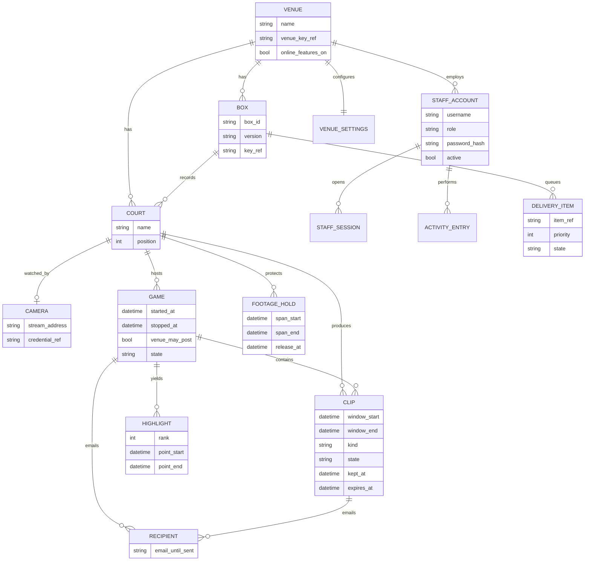
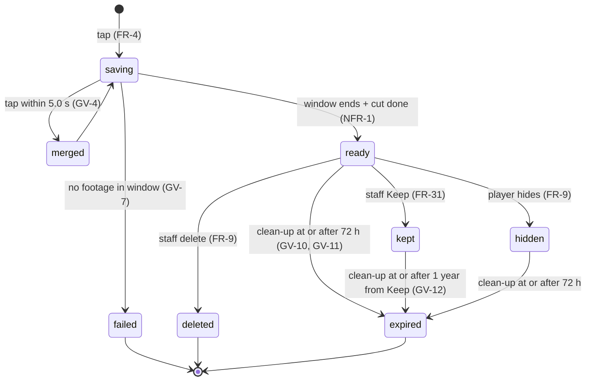
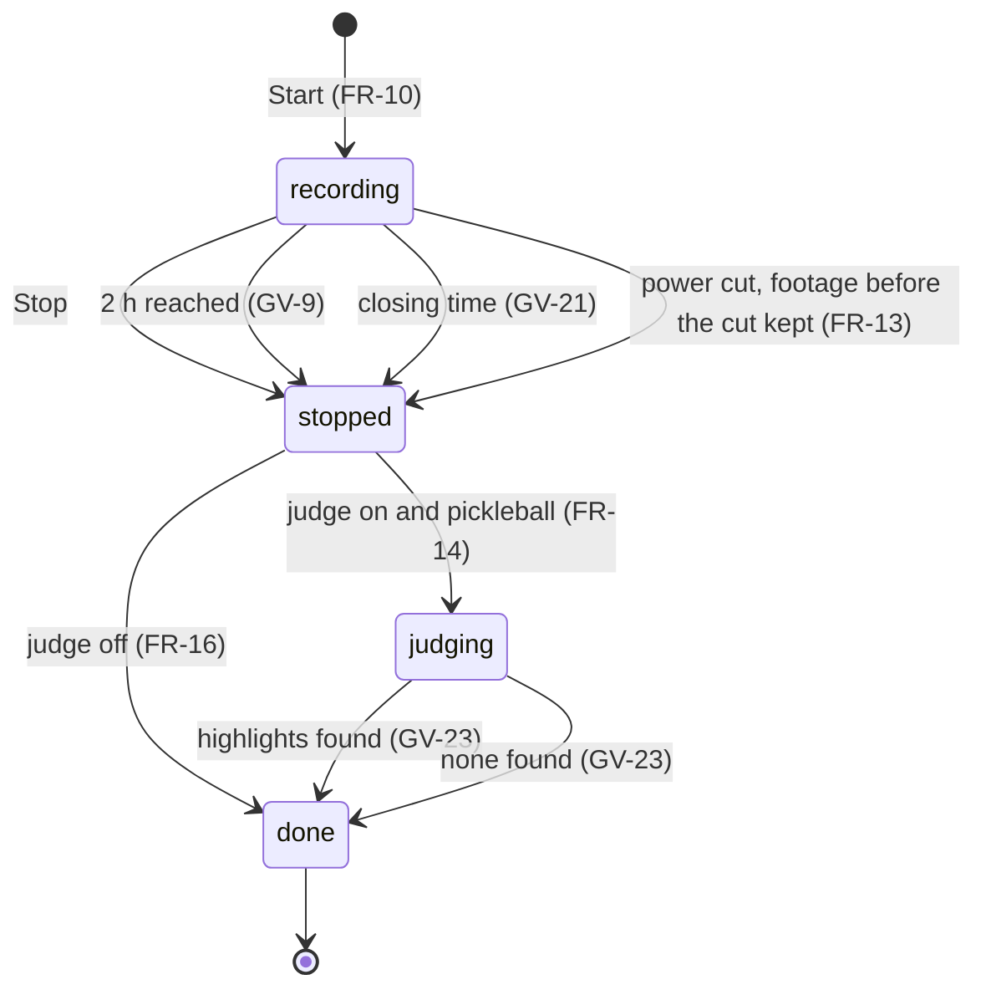
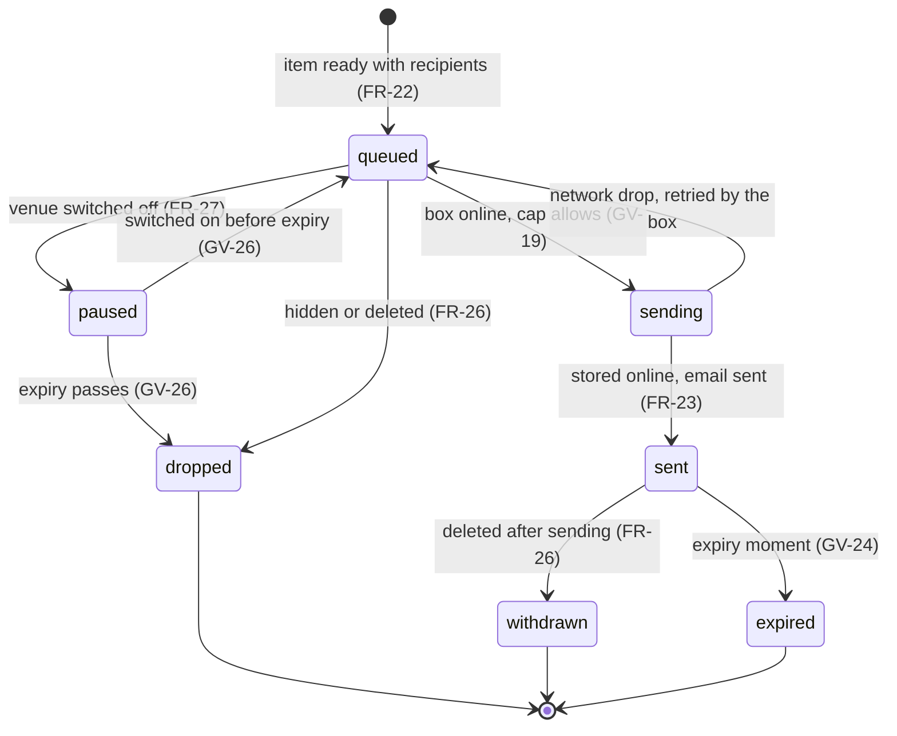
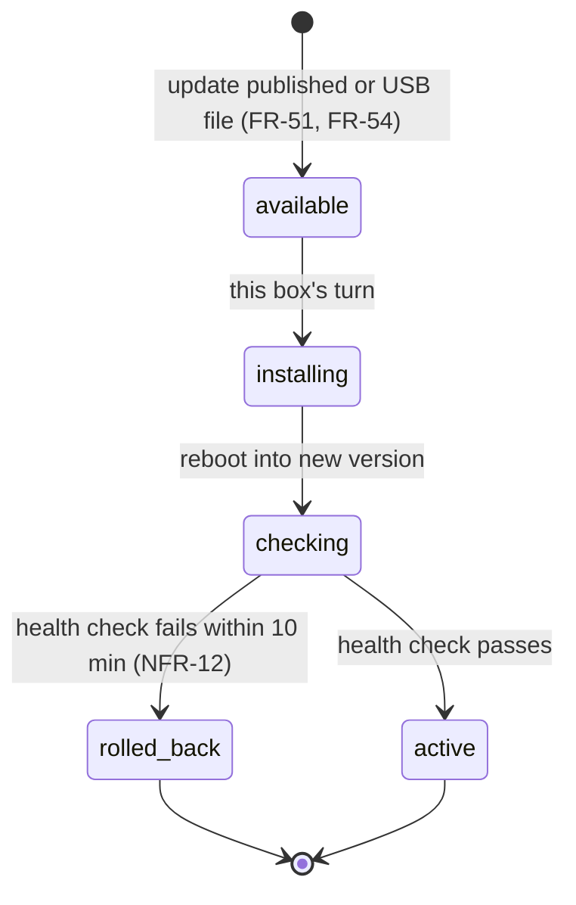
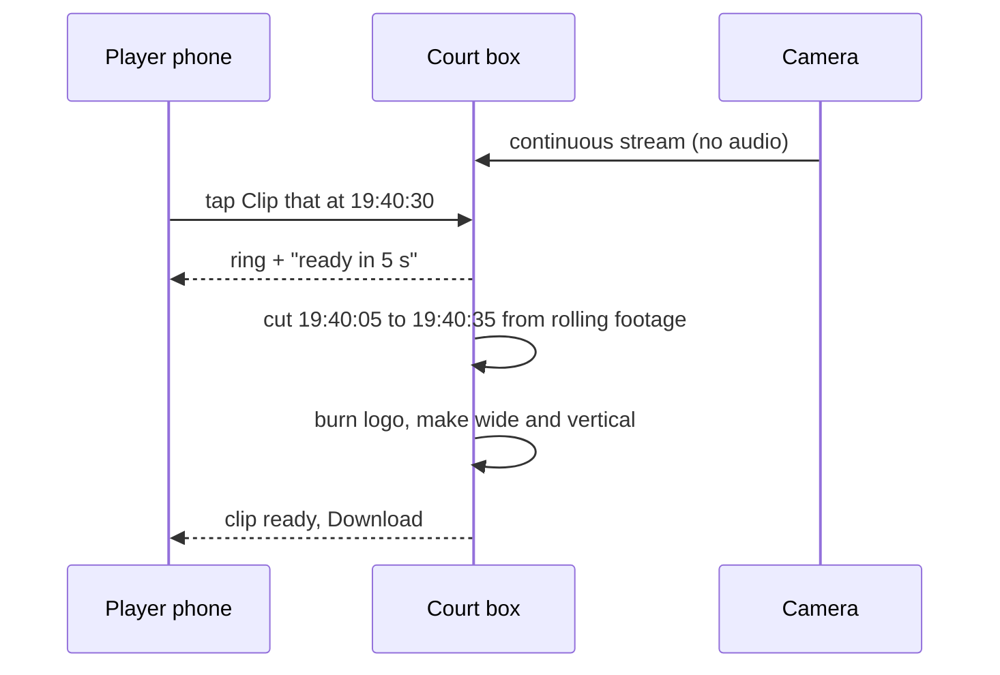
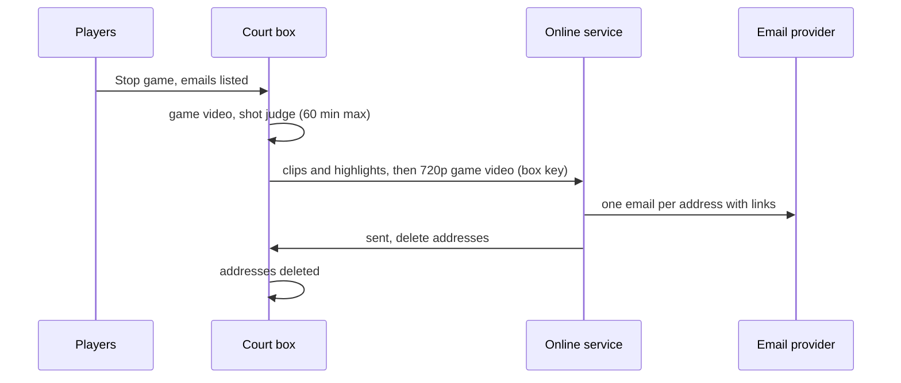
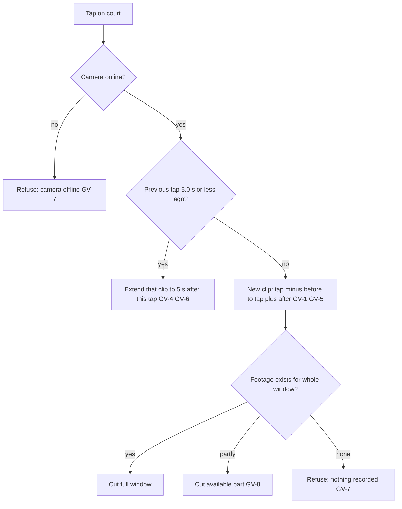
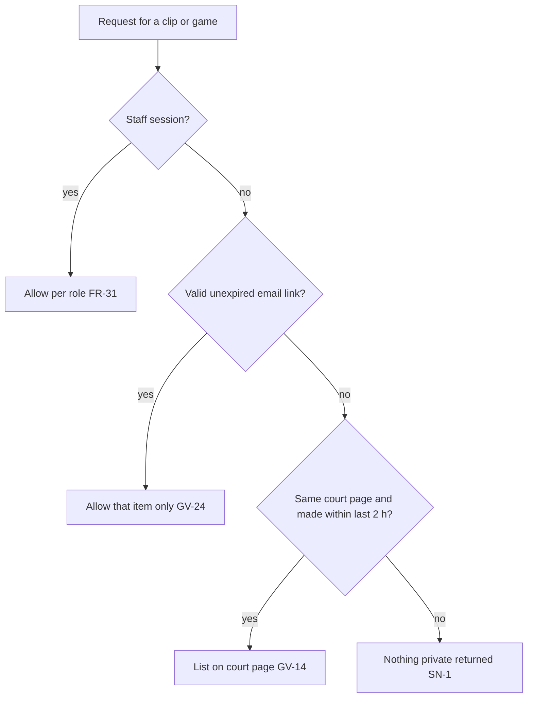
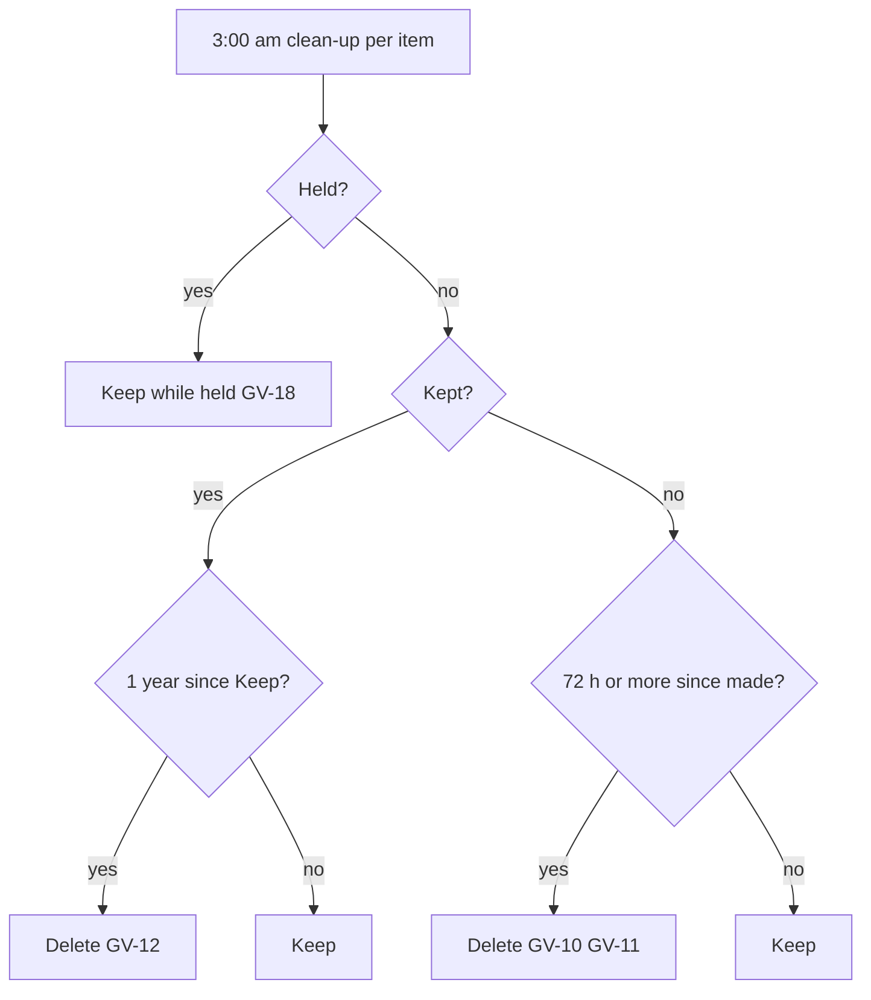

# Court Highlights — Software Requirements Specification

**FINAL · approved by the owner on 2026-10-21 · client-review revision 19.** Items marked *(confirmed at sign-off)* are
numbers or boundaries introduced while translating the approved decisions into testable rules; each was read back and
confirmed individually ("All 20 correct", "Approve as final").

> **Change record, 2026-10-22: venue network only (owner decision).** The owner's instruction: *"remove all cloud
> functionalities here. This system should be fully local (only works on LAN, wifi)"*. The online service, take-home
> email and the fleet console are removed. Nothing leaves the venue network, and the boxes make no internet calls.
> The text below is kept as approved on 2026-10-21; where it conflicts with this record, this record wins.
>
> - **Removed:** FR-20…FR-27 (email list, Email me this, store and forward, take-home email, link expiry, never
>   again, hidden means unsent, venue online switch), FR-47…FR-53 (fleet sign-in, box registration, fleet health,
>   online switch, fleet updates, fleet log, no footage in the fleet), NFR-14 (check-ins), NFR-16 (online cost);
>   golden vectors GV-15, GV-19, GV-24, GV-26 and GV-10's email text; the online service's records in §6 and its
>   rows in §9, §10 and §12 (HOST-*, SEC-CROSS-VENUE, SEC-SN6, SEC-ONLINE-TRANSPORT, the managed secret store,
>   DEV-COST-MODEL, MON-FLEET-CHECKINS, PERF-UPLOAD-CAP).
> - **Changed:** FR-12, the game video is kept in one copy (no 720p email copy). FR-17, the court page has no email
>   panel. FR-18, older items are reachable by staff only. FR-33, no upload cap. FR-35, no online-switch entries.
>   FR-38, time comes from the clock battery, the Owner's correction and the venue's time-leading box. FR-42, venue
>   sync carries staff, settings and courts. FR-45, there are no online copies to clean up. FR-55, wiping erases the
>   box; there is no fleet to leave. FR-57, the privacy notice is linked from the court page. NFR-6, the court page
>   and the staff console. NFR-9, ASVS Level 1 for the boxes. NFR-12, updates come as a signed file on a USB stick,
>   installed box by box by the Owner. NFR-15, box logs.
> - **Stored data:** a box migration deletes stored player addresses, the send queue and the online-service settings.
>   The unused columns stay, so an update can still roll back to the release before this change.
> - **Follow-up:** the build spec (`court-highlights.spec.yaml`, `court-highlights.checks.json`) still carries the
>   removed rows. It needs re-baselining in a requirements session before the next acceptance run.

Companion documents: [client-review.md](client-review.md) (the owner's decisions, A-1…A-125, and the reviewed
scenarios) · [domain-brief.md](domain-brief.md) (category recon, Philippine privacy rules, sources) ·
[stack/stack-decision.md](stack/stack-decision.md) (technology decision, `STACK_DECISION: READY`) ·
[wireframes/index.html](wireframes/index.html) (throwaway screen studies).

## 1. Purpose, users and scope

Court Highlights is a court-camera system that the owner sells and installs at Philippine pickleball venues (A-2). One
ordinary PoE security camera watches each court; small Intel mini PCs ("court boxes", about 4 courts each) at the venue
record continuously during opening hours, cut branded clips the moment a player taps **Clip that**, record whole games,
and pick each started game's best shots within an hour. Everything works with **no internet** (A-3): players reach the
court page by scanning the court code on the venue Wi-Fi and download on court. When the venue has internet, boxes send
finished clips to the owner's online service, which emails them to the players who asked, and report box health to the
owner's fleet console. No sound is ever recorded (A-37). The first venue and trial court is **Paddle Point Leisure Hub,
Cagayan de Oro** (A-109).

| Stakeholder | Role in the system | Goals |
|---|---|---|
| Owner (you) | Builds, sells, installs, supports and maintains the system; runs the fleet console and online service; processor of venue footage (A-2, A-54, A-115) | Steady per-venue income; low install and support cost; no privacy trouble |
| Venue owner | Owns the boxes and cameras (A-68), controls its footage (A-54); Owner role in the staff console | Courts people choose; free branded marketing; nothing for the front desk |
| Venue staff | Staff role: health, clip library, footage requests, signs (A-11) | Every court recording; quick answers to players |
| Venue content creator | Uses a Staff account to pick and export clips (A-11, US-8) | Postable clips the players agreed to (A-101) |
| Player | No account; scans the court code (A-9) | The shot on the phone before leaving; no app; not watched by strangers |
| Installer | Fleet Installer role: registers and installs boxes (A-104) | Repeatable installs |
| Reviewer (to be named) | Signs off the privacy and legal points before any venue goes live (A-59) | Lawful operation |

Success (A-8): in the first month at the trial venue, at least half of started games produce at least one clip or
highlight, and the speed targets of NFR-1…NFR-3 hold.

### 1.1 Priorities and boundaries

All functional requirements below are **Must** unless marked otherwise; the owner made automatic highlights a Must (A-21).
**Won't (this release):** live streaming, court booking, player payments, a camera that follows the ball, PB Passport
linking (A-42), the clubhouse TV (A-29), sound (A-37), automatic highlights for sports other than pickleball (A-4),
shot-type captions (A-97), a second sign-in factor on the venue staff console *(confirmed at sign-off: LAN-only console, lockout and encryption instead)*,
mirrored disks (A-63). Consequences are in §11.

### 1.2 Evidence and provenance

Every requirement carries one provenance tag: **stated** (the owner said it), **derived-domain** (domain recon surfaced
it, the owner confirmed it), **default-confirmed** (a visible Forge proposal the owner accepted). The translation
details were read back individually and confirmed at sign-off (§12.2); there are no open items.

## 2. Controlled vocabulary

| Preferred term | Definition | Avoid |
|---|---|---|
| Venue | The club or facility that bought the boxes and cameras | tenant, site, org |
| Court | One playing area with one camera | field, lane |
| Camera | The PoE network camera watching one court | cam, NVR channel |
| Court box (box) | The small computer at the venue that records, cuts and serves pages for about 4 courts | server, NVR, edge node |
| Rolling footage | The last 4 hours of recording a box keeps per court; older footage is overwritten | buffer, DVR, cache |
| Clip | A short saved piece made by a tap (25 s before + 5 s after by default) | replay, capture |
| Game | A recording from Start to Stop on one court | session, match recording |
| Game video | The video of a whole game | full match |
| Highlights | The best points of a started game, picked by the shot judge: one reel plus up to 5 single points | auto-clips |
| Shot judge | The box function that finds and ranks best points | AI, model (in player-facing text) |
| Court code | The printed QR code on the court sign that opens that court's page | QR link |
| Court page | The phone page for one court: Clip that, game panel, emails, recent clips | app, portal |
| Clip that | The one-tap save button | record, capture |
| Keep | Staff mark that stops a clip expiring (up to 1 year) | archive, pin |
| Hold | Staff mark that stops footage being overwritten while a footage request is handled | freeze, preserve |
| Expire | Automatic deletion at the first 3:00 am clean-up ≥ 72 h after a clip or game video was made | purge |
| Staff console | Venue staff pages on the boxes | admin panel, backend |
| Fleet console | The owner's online pages for all venues' boxes | admin, dashboard |
| Online features | Email sending and updates for a venue; the owner's on/off switch | subscription, licence |
| Take-home email | The email a player gets with links to their game video, clips and highlights | notification |

## 3. User stories and acceptance journeys

| ID | Story (INVEST) |
|---|---|
| US-1 | As a player, I want to save the last half-minute with one tap, so that I keep a great rally I never planned to record. |
| US-2 | As a player, I want to record our whole game, so that we can watch it back. |
| US-3 | As a player, I want my videos on my phone with no app and no account, even if the venue has no internet, and by email when it does. |
| US-4 | As a player, I want a vertical version, so that I can post it straight to TikTok or Reels. |
| US-5 | As a venue owner, I want my logo on every clip, so that every share advertises my courts. |
| US-6 | As a venue owner, I want to set up courts and cameras and print court signs myself. |
| US-7 | As venue staff, I want to see at a glance that every court is recording. |
| US-8 | As a venue content creator, I want to browse clips across courts and export the ones players agreed to share. |
| US-9 | As a venue owner, I want clips to delete themselves after a few days. |
| US-10 | As a player, I want my best shots found for me, so that I don't have to remember to tap. |
| US-11 | As a venue owner, I want to answer a footage or deletion request properly. |
| US-12 | As a venue owner, I want to add and remove staff. |
| US-13 | As the owner, I want to install, monitor, switch off and update boxes at many venues cheaply. |

The scenarios below were reviewed by the owner as accurate (client-review rev 13); each becomes an end-to-end acceptance
journey. Names and times are invented examples.

| ID | Journey (retold with the system in place) | Unhappy and recovery paths |
|---|---|---|
| SC-1 | Mia scans the Court 2 code on the venue Wi-Fi, taps **Clip that** at 7:40:30 pm; the ring fills and her phone buzzes; by ~7:40:45 the 7:40:05–7:40:35 clip with the venue logo is on her page, wide and vertical; she downloads it. | Camera offline → "Court 2 camera is offline — clips aren't available", nothing saved. Three quick taps → one clip. Wrong court → she hides the clip. |
| SC-2 | Her group taps **Start** at 6:02 pm (venue may post: off), plays, taps **Stop** at 6:58; the game video is downloadable on court. | Forgot to stop → stops at 8:02 pm. Second group taps Start → told a game is recording since 6:02 and offered Stop. Power cut → the part before the cut is kept. |
| SC-3 | Each player types an email under **Send our videos to** (max 8); after Stop, when the venue is online, each gets one email with the 720p game video, clips and highlights, "available until Fri 3:00 am". | Venue offline → "Emails go out when the club is back online". Mistyped address → removable until sent; a wrong recipient can block it. Link after expiry → "These videos have expired". |
| SC-4 | The installer mounts cameras, plugs in 3 boxes, installs from USB; the owner runs the wizard (owner password, venue name, logo, hours), names Courts 1–12 from previews, prints 12 signs. | Camera not found → typed address and password. Wrong name → fixed in Courts. |
| SC-5 | At opening, staff see 12 green courts and disk use; a red court's cable is replugged and turns green. Recording follows opening hours; 3:00 am clean-up removes expired clips. | Disk ≥ 80 % → warning; footage never shrinks below 4 h. |
| SC-6 | Jo filters "yesterday, all courts, venue may post", keeps 5 clips, downloads their vertical versions. | A clip without permission → warning, choice logged. |
| SC-7 | A parent asks about a fall on Court 4 at 5 pm: staff find the footage, **Hold** it (≤ 60 days), the owner exports it; the log records who, what, when. | Already overwritten → recorded as "footage no longer exists". A player asks for deletion → staff delete; logged. |
| SC-8 | The owner adds Ken (Staff) with a temporary password; Ken sets his own. Ken leaves → deactivated; his session stops on every box. | 5 wrong passwords → that account locked 15 min on every box. |
| SC-9 | An update fails its health check → the box returns to the old version ("Update rolled back"); boxes update one at a time. A dead box is replaced and copies settings and staff from its siblings. | A single-box venue restores its settings backup file. |
| SC-10 | Players stop a 1-hour game → "Highlights coming — about 25 min" → up to 5 best points + one reel, wide and vertical, on the page and in the email, within 60 min. | No game started → no highlights. Dull pick → ignored, nothing deleted. None found → "No highlights found". Two courts stop together → queued. |
| SC-11 | A venue closes: the owner exports settings, types the venue name, **Wipe box** erases everything; the box leaves the fleet console; the venue keeps the hardware. | — |
| SC-12 | Internet drops at 5 pm; clipping and downloading continue; at 8 pm the box sends waiting clips and highlights first, then game videos, within the upload cap; emails go out; addresses are deleted. | A clip hidden or deleted before sending is never sent. |
| SC-13 | A venue's invoice is late: the owner switches its online features off with a reason; emails and updates stop, recording continues, court pages hide the email box; switched back on → waiting videos within expiry go out. | — |
| SC-14 | Box B (Courts 5–8) loses power: Courts 1–4 and 9–12 keep working; the console shows Courts 5–8 "box unreachable since 7:02 pm"; the fleet console flags the missed check-in; power returns → Box B catches up and sends. | — |
| SN-1…SN-6 | Refused: browsing another court's or older clips by editing the address; guessing staff passwords; an ex-staff session; a fake or oversized logo; reading a stolen box's disk; spamming addresses or guessing email links. | See §9. |

## 4. Functional requirements and Given/When/Then acceptance

| ID | Requirement | Priority | Provenance | Decisions / journey | Dimension | Given / When / Then |
|---|---|---|---|---|---|---|
| FR-1 | **Rolling recording:** each box records every assigned camera's main stream by stream copy (no re-encode, no audio) during the venue's opening hours, keeping the last 4 h per court. | Must | default-confirmed | A-17, A-56, A-36, A-37; SC-5 | functional, logic | Given opening hours 06:00–23:00, when the clock passes 06:00:00, then recording starts on every assigned court, and at 21:00 the oldest retained footage is from 17:00 (GV-13, GV-21). |
| FR-2 | **No sound:** the box never requests, stores or sends an audio track. | Must | stated | A-37 | hardening | Given a camera that offers audio, when a clip, game video or footage export is produced, then the file has no audio track. |
| FR-3 | **Camera loss and recovery:** an unreachable camera turns its court red in the console within 10 s *(confirmed at sign-off)*, its court page says clips are unavailable, and recording resumes ≤ 5 s after the camera returns. | Must | default-confirmed | A-61; SC-1, SC-5 | functional, monitoring | Given Court 3 recording, when its camera is unplugged for 30 s and replugged, then the court shows red within 10 s and recording resumes ≤ 5 s after the stream returns. |
| FR-4 | **Clip that:** a tap saves the footage from 25 s before to 5 s after the tap (venue-adjustable 10–60 s before, 0–15 s after), limited to footage that exists. | Must | default-confirmed | A-15; SC-1 | logic, functional | Given defaults, when a player taps at 19:40:30, then a clip 19:40:05–19:40:35 is saved (GV-1…GV-3, GV-8). |
| FR-5 | **Tap merging:** a tap ≤ 5.0 s after the previous tap on the same court joins that clip, which then ends 5 s after the last tap. | Must | default-confirmed | A-22; SC-1 | logic | Given taps at 19:40:30 and 19:40:35, when the second tap arrives, then one clip 19:40:05–19:40:40 results; taps 6 s apart make two clips (GV-4…GV-6). |
| FR-6 | **Branding:** the venue logo (and optional sponsor logo) is burned into every clip, highlight and game video in the corner the venue chose. | Must | derived-domain | A-19, A-107, A-110; US-5 | functional | Given a logo set to bottom-right, when any clip, highlight or game video is produced, then the logo appears bottom-right in every frame of both versions. |
| FR-7 | **Two shapes:** every clip and highlight is produced in a wide version and a vertical 9:16 version cut from the middle of the frame. | Must | derived-domain | A-20; US-4 | functional | Given a saved clip, when it is ready, then a 16:9 and a 9:16 file are both downloadable. |
| FR-8 | **Saving feedback:** after a tap the court page shows a ring that fills over the clip's remaining window with "Saving… ready in N s" and vibrates once where the phone allows; with reduced motion the ring is static and the countdown is text. | Must | stated | A-108; SC-1 | ux | Given a phone with reduced motion on, when a player taps Clip that, then no animation runs and the text countdown updates each second. |
| FR-9 | **Correction:** a player can hide a clip from the court page they are on; staff can delete any clip or game video; deletion is permanent and logged. | Must | default-confirmed | A-23; SC-1, SC-7 | functional | Given a clip on Court 2's page, when a player hides it, then it no longer appears on that page and is never sent; when staff delete it, it is gone from the library and the log records who and when. |
| FR-10 | **Games:** Start marks the beginning, Stop the end; one game per court; a game stops itself after 2 h or at closing time, whichever is first *(confirmed at sign-off: closing time)*; a second group sees the running game and may stop it. | Must | default-confirmed | A-16; SC-2 | logic, functional | Given a game started at 18:02:00, when nobody stops it, then it stops at 20:02:00 (GV-9); given a game started at 22:30 and closing at 23:00, it stops at 23:00 (GV-21). |
| FR-11 | **Posting permission:** Start offers "The venue may post our highlights on its pages", off by default; the choice is stored with the game. | Must | stated | A-101; SC-2, SC-6 | functional | Given a game started without ticking, when staff view its clips, then they show "may post: No". |
| FR-12 | **Game video:** after Stop the full-quality game video is downloadable on court; a 720p version is made for email. | Must | stated | A-105; SC-2, SC-3 | functional | Given a stopped game, when its video is ready, then the court page offers a download and the delivery queue holds a 720p version. |
| FR-13 | **Power cut during a game:** footage recorded before the cut is saved as that game's video; recording resumes by itself when power returns. | Must | default-confirmed | A-34, A-60; SC-2 | functional | Given a game recording, when power is cut at 18:40 and restored, then a game video ending ≈ 18:40 exists and recording resumes without staff action. |
| FR-14 | **Highlights:** for started pickleball games only, after Stop the shot judge picks up to 5 best points (long rallies, kitchen hand battles, put-aways/smashes, spectacular shots); each is the whole point, at most 20 s, ending 2 s after the point ends; best first; one reel plus single points; wide and vertical; no captions. | Must | stated | A-21, A-88, A-89, A-92, A-97; SC-10 | functional, ux | Given a stopped 1-hour game with 3 qualifying points, when judging ends, then the page shows a reel and 3 single points labelled "Highlights" (GV-22, GV-23). |
| FR-15 | **Highlight timing:** every reel is ready ≤ 60 min after Stop, including queueing; until then the court page shows "Highlights coming — about N min". | Must | stated | A-93; SC-10 | functional, monitoring | Given 4 courts stopping 1-hour games at once, when judging runs, then all 4 reels are ready within 60 min (NFR-3). |
| FR-16 | **Judge is advisory:** the shot judge never deletes or hides anything; the venue Owner can switch it off; with it off, clips and games still work and no highlights are made. | Must | default-confirmed | A-41; SC-10 | functional | Given the judge switched off, when a game stops, then the game video is produced and no "Highlights coming" message appears. |
| FR-17 | **Court page:** opening a court code shows, without sign-in: venue logo, court name, recording status, Clip that, the game panel, the email panel and clips from this court made in the last 2 h. | Must | default-confirmed | A-9, A-10, A-112; SC-1 | functional, ux | Given a phone on the venue Wi-Fi, when it opens Court 2's code, then the page shows those parts in that order with no sign-in. |
| FR-18 | **Clip privacy:** clip and game links are unguessable; a court page lists only that court's items made within the last 2 h (inclusive); older items are reachable only by staff or through an unexpired email link. | Must | default-confirmed | A-10; SN-1 | hardening, logic | Given a clip made at 18:59:59, when Court 2's page is opened at 21:00:00, then it is not listed; requesting another court's or an older clip by changing the address returns nothing private (GV-14). |
| FR-19 | **Download:** players download clips and game videos as MP4 to their phone from the court page. | Must | default-confirmed | A-25; SC-1 | functional | Given a ready clip, when Download is tapped on an Android and an iPhone browser, then an MP4 is saved. |
| FR-20 | **Email list:** during a game anyone on that court page can add an email under "Send our videos to"; at most 8 per game; any address can be removed until the game's email is sent; the notice "Used only to send these videos; deleted after sending. Under 18? Ask a parent first." and a privacy-notice link appear beside the box. | Must | stated | A-79, A-84, A-85, A-86, A-58; SC-3 | functional, logic | Given 8 addresses on a game, when a 9th is added, then it is refused with "Up to 8 addresses per game" (GV-15). |
| FR-21 | **Email me this:** a clip tapped with no game running offers its own email box (same limits and notice). | Must | default-confirmed | A-84; SC-3 | functional | Given no game on Court 2, when a clip is ready, then it shows "Email me this". |
| FR-22 | **Store and forward:** when a box is online and its venue's online features are on, it sends finished clips and highlights (1080p) first, then game videos (720p), oldest game first within each group, under the installer's upload cap; rolling footage and full-quality game videos never leave the venue. | Must | stated | A-3, A-83, A-105; SC-12 | functional, logic | Given a queue with games A (stopped 17:00) and B (18:00), when the line returns, then the send order is A's clips/highlights, B's clips/highlights, A's video, B's video (GV-19). |
| FR-23 | **Take-home email:** the online service sends each address one email per game (or per Email-me-this clip) listing links to the game video, clips and highlights with their expiry time, then deletes the addresses from the box and the service. | Must | stated | A-79, A-87, A-30; SC-3 | functional | Given a sent game, when the email is delivered, then it contains the links and "available until Fri 23 Oct 2026, 3:00 am", and neither the box nor the service still stores the addresses. |
| FR-24 | **Link expiry:** an email link stops working at the same moment the box copy expires; afterwards it shows "These videos have expired". | Must | default-confirmed | A-18, A-80; SC-3 | logic | Given a clip made Mon 19 Oct 19:40, when its link is opened on Fri 23 Oct at 03:00 or later, then it shows the expired message (GV-10, GV-24). |
| FR-25 | **Never again:** every email has "This isn't me — don't email me again"; that address and any hard-bounced address is never emailed by any venue again. | Must | default-confirmed | A-86, A-125; SN-6 | hardening | Given a blocked address, when a new game lists it, then no email is sent to it. |
| FR-26 | **Hidden means unsent:** a clip hidden or deleted before sending is never sent; if already sent, the online copy is deleted. | Must | default-confirmed | A-83; SC-12 | functional | Given a clip deleted after it was sent, when its email link is opened, then it is no longer available. |
| FR-27 | **Venue online switch:** with a venue's online features off, its boxes send nothing and take no updates; recording, clips and on-court downloads continue; court pages hide the email box and say "Download your videos here — email isn't available at this venue"; when switched back on, waiting videos still within expiry are sent. | Must | stated | A-82, A-100; SC-13 | functional, logic | Given a venue switched off on Mon and on again Wed, when the box reconnects, then videos not yet expired are sent and expired ones are not (GV-26). |
| FR-28 | **Staff sign-in:** staff sign in with username and password over the box's encrypted staff connection; roles Owner and Staff; sessions end after 12 h; 5 consecutive wrong passwords lock that account for 15 min on every box at the venue *(confirmed at sign-off: "consecutive")*. | Must | default-confirmed | A-11, A-12, A-49, A-124; SC-8 | hardening, functional | Given 5 consecutive failures at 10:00, when the right password is entered at 10:10, then it is refused, and at 10:15 it is accepted (GV-16, GV-17). |
| FR-29 | **Staff management:** the Owner adds staff with a temporary password that must be changed at first sign-in and expires after 72 h unused *(confirmed at sign-off)*; deactivates staff, ending their sessions on every box within 1 min; resets Staff passwords; a lost Owner password is reset with a USB reset file plugged into a box. | Must | default-confirmed | A-12, A-13, A-103; SC-8 | functional, hardening | Given Ken deactivated at 14:00, when his open session makes a request at 14:01 on another box, then it is refused. |
| FR-30 | **Courts and cameras:** the Owner adds, renames and removes courts; assigns a camera found on the network or entered by address and password; sees a live preview. | Must | default-confirmed | A-77; SC-4 | functional | Given a new court, when a camera is assigned, then its preview appears and the court starts recording at the next opening time. |
| FR-31 | **Clip library:** across all of the venue's boxes; filters by court, date, type (tap, highlight, game), kept and "venue may post"; 50 per page; actions Keep (up to 1 year), Download wide/vertical, Delete; downloading a clip without posting permission "for posting" shows a warning and logs the choice. | Must | default-confirmed | A-31, A-72, A-73, A-101, A-18; SC-6 | functional, ux | Given 612 matching clips, when the library loads, then it shows 1–50 of 612 with the active filters and a Clear filters action. |
| FR-32 | **Footage requests:** staff find rolling footage by court and time window, put a Hold on it (released by staff or automatically after 60 days), and the Owner exports it as MP4; if it no longer exists, they record that; every step is logged. | Must | derived-domain | A-57; SC-7 | functional, logic | Given footage of Court 4 at 17:00 held at 17:30, when 4 h pass, then the held span is not overwritten; a hold placed 20 Oct 10:00 releases 19 Dec 10:00 (GV-18). |
| FR-33 | **Venue settings:** venue name, logo (PNG or JPEG ≤ 2 MB), logo corner, optional sponsor logo, opening hours, clip lengths, upload cap, shot judge on/off, privacy-notice text, time correction. | Must | default-confirmed | A-78, A-52, A-105, A-41, A-64, A-125 | functional, hardening | Given a 3 MB logo or a renamed executable, when it is uploaded, then it is refused and nothing is stored. |
| FR-34 | **My account:** every staff member can change their own password. | Must | default-confirmed | A-78 | functional | Given a signed-in Staff member, when they change their password, then the old one stops working. |
| FR-35 | **Activity log:** records sign-ins (success and failure), keep, delete, export, download-for-posting, holds, settings, staff and online-switch changes with who and when, never player emails or passwords; exportable as CSV. | Must | default-confirmed | A-51, A-31, A-66; SC-7 | hardening, monitoring | Given a deleted clip, when the log is exported, then a row names the staff member, action, item and time, and no row contains an email address. |
| FR-36 | **Health page:** per court: recording, camera reachable, last clip time; per box: free disk, temperature, version, reachable; warning at 80 % disk. | Must | default-confirmed | A-65, A-33, A-102; SC-5, SC-14 | monitoring | Given Court 6's camera unplugged, when staff open Health, then Court 6 is red with "camera offline since …". |
| FR-37 | **Court signs:** the console prints one sign per court with the court code, "This court is recorded (no sound)", the purpose, "footage kept 4 hours, clips 3 days", the venue contact, "Join the venue Wi-Fi first" and "Under 18? Ask a parent first." | Must | derived-domain | A-53, A-58; SC-4 | functional | Given 12 courts, when signs are printed, then 12 pages each carry that court's code and the notice text. |
| FR-38 | **Time:** boxes keep time with their clock battery; the Owner can correct it; all boxes at a venue use the same time; online boxes also take time from the online service. | Must | default-confirmed | A-64 | functional | Given box time off by 3 min, when the Owner corrects it, then all the venue's boxes show the corrected time within 1 min. |
| FR-39 | **Help:** the console's Help page shows the owner's support number and hours (7 days, about 6 am–11 pm). | Must | stated | A-67 | ux | Given any staff member, when Help is opened, then the support number is shown. |
| FR-40 | **Onboarding:** a new box starts empty with no default account; the first-run wizard sets the Owner password, venue name, logo and opening hours, finds cameras, names courts with previews, and prints signs, illustrated with line drawings (camera position, court sign); the empty clip library explains how to make the first clip. | Must | default-confirmed | A-75, A-107, A-46, A-34; SC-4 | functional, ux | Given a freshly installed box, when its address is opened, then the wizard appears and no sign-in with any built-in account works. |
| FR-41 | **One console per venue:** any box shows the whole venue's console; each box keeps its own courts' data; an unreachable box's courts show "box unreachable since …" while the rest work. | Must | default-confirmed | A-102; SC-14 | functional | Given Box B powered off, when the console is opened on Box A, then Courts 5–8 show unreachable and Courts 1–4, 9–12 work. |
| FR-42 | **Venue sync:** staff accounts, venue settings and the online switch are the same on every box at a venue; a change reaches the others within 1 min, or as soon as an unreachable box returns; boxes trust each other only through the venue key set at install. | Must | default-confirmed | A-103, A-125; SC-8 | functional, hardening | Given a device without the venue key, when it calls a box's sync interface, then it is refused. |
| FR-43 | **Replacing a box:** a new box joins the venue and receives settings and staff from its siblings; at a single-box venue the Owner restores a settings backup file. | Must | default-confirmed | A-62; SC-9 | devops | Given a replaced Box B, when it joins, then its courts, logo and staff match the venue within 1 min. |
| FR-44 | **Settings backup:** the Owner exports and imports a settings backup file (courts, cameras, logo, hours, staff accounts with password hashes only). | Must | default-confirmed | A-62 | devops, hardening | Given an exported backup, when it is opened as text, then it contains no plaintext passwords. |
| FR-45 | **Clean-up:** at 3:00 am each box deletes clips and game videos ≥ 72 h old that are not kept or held, kept items ≥ 1 year after Keep *(confirmed at sign-off: measured from the Keep action)*, and expired online copies. | Must | default-confirmed | A-18, A-57; SC-5 | logic | Given a clip made Mon 03:00:00, when the Thu 03:00 clean-up runs, then it is deleted; one made Mon 03:00:01 is deleted Fri 03:00 (GV-10…GV-12). |
| FR-46 | **Disk pressure:** at 80 % the console warns; at 90 % the box deletes the oldest unkept, unheld game videos, then clips, until below 85 %; rolling footage never drops below 4 h *(confirmed at sign-off: 90 %/85 %)*. | Must | default-confirmed | A-33 | logic, monitoring | Given a disk at 91 %, when the check runs, then the oldest unkept game videos are deleted until usage is below 85 % and the 4 h of rolling footage remains (GV-20). |
| FR-47 | **Fleet sign-in:** the fleet console requires password plus a one-time code from an authenticator app; roles Admin and Installer. | Must | default-confirmed | A-104 | hardening | Given a correct password and no code, when signing in, then access is refused. |
| FR-48 | **Box registration:** an Installer registers a box to a venue in the fleet console, which issues that box its own secret key; an Admin can revoke a key, after which that box's uploads and reports are refused. | Must | default-confirmed | A-125; SC-4, SC-11 | hardening | Given a revoked key, when the box uploads a clip, then the service refuses it and stores nothing. |
| FR-49 | **Fleet health:** per venue and box: last check-in, version, disk, temperature, courts recording; a box that misses check-ins for 5 min *(confirmed at sign-off)* is flagged; health records are kept 90 days. | Must | default-confirmed | A-81, A-65, A-125; SC-14 | monitoring | Given Box B silent for 6 min, when the fleet console is opened, then Box B is flagged "missed check-in". |
| FR-50 | **Online switch:** an Admin switches a venue's online features off or on with a reason; the change is logged. | Must | stated | A-82; SC-13 | functional | Given Riverside switched off with reason "invoice late", when the log is viewed, then it shows who, when and the reason. |
| FR-51 | **Fleet updates:** an Admin publishes an update; boxes at a venue install it one at a time; a box whose health check fails returns to its previous version by itself and reports "rolled back". | Must | default-confirmed | A-47, A-14; SC-9 | devops | Given an update that fails its health check on Box A, when it installs, then Box A runs the previous version and Boxes B and C are not updated. |
| FR-52 | **Fleet log:** registrations, key revocations, switches, updates and sign-ins in the fleet console are logged with who and when. | Must | default-confirmed | A-125 | hardening, monitoring | Given a key revocation, when the fleet log is viewed, then it names the Admin and time. |
| FR-53 | **No footage in the fleet:** the fleet console and its accounts cannot list, view or download any clip, game video or footage. | Must | stated | A-81 | hardening | Given an Admin session, when it requests any clip URL or clip-listing interface, then access is refused. |
| FR-54 | **Box updates offline:** an update file on a USB stick installs from the console with the same health check and automatic return to the previous version. | Must | default-confirmed | A-47; SC-9 | devops | Given a failing update from USB, when it installs, then the console shows "Update rolled back" and recording resumes on the old version. |
| FR-55 | **Wipe box:** the Owner types the venue name to confirm; the box erases all footage, clips, games, accounts and logs after an optional settings export and is removed from the fleet. | Must | default-confirmed | A-70, A-68; SC-11 | hardening | Given a wiped box, when its disk is inspected, then no clip or account data remains, and the fleet no longer lists it. |
| FR-56 | **Survives restarts:** saved clips, games, holds, settings and accounts survive restarts and power cuts; recording resumes within 60 s of the box finishing start-up *(confirmed at sign-off)*. | Must | default-confirmed | A-34, A-60; SC-2, SC-14 | functional | Given 3 saved clips, when the box is power-cycled, then the 3 clips, settings and accounts are present and recording resumes. |
| FR-57 | **Privacy notice:** each venue's privacy notice (from Forge's template, finalised by the venue's reviewer) is linked from the court page and email boxes. | Must | default-confirmed | A-85, A-125, A-59 | functional | Given a venue notice saved in settings, when a player taps the link, then it opens on the box without internet. |

## 5. Non-functional requirements

| ID / dimension | Measurable requirement | Decisions | Provenance | Validation |
|---|---|---|---|---|
| NFR-1 / monitoring | **Clip speed:** with a box recording all 4 of its courts and encoding one 720p game video, a clip with logo is ready (wide + vertical) ≤ 10 s after its window ends for 95 of 100 taps. | A-44 | default-confirmed | Spike H2 and build load test: ≥ 100 taps × ≥ 5 runs, p95 reported. |
| NFR-2 / monitoring | **Recording continuity:** no gap > 2 s per court over 24 h at full load. | A-44 | default-confirmed | 24 h soak with 4 replayed streams; gap detector over segment timestamps. |
| NFR-3 / monitoring | **Highlight throughput:** each box judges ≥ 4 h of footage per hour; with all 4 courts stopping 1-hour games at once, all reels are ready ≤ 60 min after Stop while NFR-1 and NFR-2 hold. | A-93, A-99 | stated | Spike H3 and build load test on the selected box; fallback ladder in the stack decision on a miss. |
| NFR-4 / ux | **Page speed:** the court page loads ≤ 2 s at p95 on the venue Wi-Fi with 100 phones connected across the venue. | A-125 | default-confirmed | Load test with 100 simulated clients against 3 boxes; Playwright timing on a throttled Wi-Fi profile. |
| NFR-5 / ux | **First use:** a first-time player saves a clip within 60 s of scanning, without help. | A-125 | default-confirmed | Human-gated: observed on the trial court with ≥ 5 first-time players; entered in qa/usability/sessions.tsv. Until then the report says "not tested with users". |
| NFR-6 / ux | **Accessibility and sun:** court page, staff console and fleet console meet WCAG 2.2 AA; body text contrast ≥ 7:1 and the Clip that label ≥ 7:1 for outdoor sun *(confirmed at sign-off: 7:1)*; actions on the court page are ≥ 48 px. | A-27 | default-confirmed | axe on every route (0 serious/critical); contrast check on DESIGN.md tokens; target-size check on the court page. |
| NFR-7 / ux | **Reduced motion:** with prefers-reduced-motion, no animation runs; every task completes by keyboard on the consoles. | A-108, A-27 | stated | Playwright with reduced-motion emulation; keyboard-only run of SC-6, SC-7, SC-8. |
| NFR-8 / hardening | **Encrypted disks:** footage, clips and the database are encrypted at rest with a key sealed to the box; the disk moved to another computer is unreadable. | A-50 | default-confirmed | Remove the disk image to another machine; mounting fails without the box. |
| NFR-9 / hardening | **ASVS level:** OWASP ASVS 5.0.0 Level 1 for the venue boxes; Level 2 for the online service and fleet console (privileged, multi-venue). Selected requirement IDs and non-applicability reasons are listed in §9.3. | A-49, A-104, A-124 | default-confirmed | Each listed ID has a passing negative test (§9.4). |
| NFR-10 / hardening | **Licence rule:** no GPL or AGPL component ships in the box software; LGPL components are dynamically linked or separate programs; an SBOM licence check passes on every release. | A-114 | stated | cargo-deny / licence scan in CI; GStreamer plugin list checked for GPL plugins. |
| NFR-11 / hardening | **Support horizon:** every pinned OS, runtime and AI-runtime component is supported through 2030-06-30. | A-116 | stated | Release checklist compares pins with endoflife data. |
| NFR-12 / devops | **Safe updates:** a failing update returns the box to its previous version within 10 min of its first boot *(confirmed at sign-off)*; venues update one box at a time. | A-47 | default-confirmed | Spike H5 and build test with an injected failing release. |
| NFR-13 / devops | **Install time:** a box goes from USB stick to the first-run wizard in ≤ 30 min *(confirmed at sign-off)*. | A-46 | default-confirmed | Timed install on the trial box. |
| NFR-14 / monitoring | **Check-ins:** online boxes report health every 60 s; a box silent for 5 min is flagged in the fleet console. | A-81, A-125 | default-confirmed | Stop a box's network; flag appears within 6 min. |
| NFR-15 / monitoring | **Logs:** box and service logs never contain player email addresses, passwords, session tokens or box keys. | A-66 | default-confirmed | Log scan during the e2e run for email/token patterns: 0 hits. |
| NFR-16 / devops | **Online cost:** the online service costs ≤ US$100/month at the year-1 upper-bound usage (≈ 550 GB/day sent, 144,000 emails/month); expected ≈ US$45–68. | A-117, A-118 | stated | Cost model in the stack evidence; first-month bill review. |
| NFR-17 / functional | **Shot-judge quality:** on the hand-marked partner-court test footage (never used for training), in ≥ 8 of 10 test games ≥ 3 of the box's top 5 are moments the markers picked and none is dead time; long rallies, hand battles and put-aways each meet that bar separately; spectacular shots count only if the footage holds ≥ 10 of each. | A-91, A-94, A-96 | default-confirmed | Scripted evaluation against the marking sheets (value matrix §8). |
| NFR-18 / devops | **Environments:** owner laptop with replayed fake cameras, a test box, and live venues; no test runs on a live venue. | A-48 | default-confirmed | CI and runbook show the three environments. |

## 6. Data model and record lifecycles

### 6.1 Records

Online records (owner's service): venue account, box registration (key hash, revoked flag), health report (kept 90 days),
sent item (clip/game video copy until expiry), blocked address (one-way hash), fleet user (role, TOTP secret), update
release, fleet log entry. Player email addresses exist only until sending (A-30). Expected volume at year 1: ~600 clips
per venue per day, ~30 boxes, ~100 courts (A-73, A-117).

### 6.2 State machines

### 6.3 Key flows

### 6.4 Decision logic

Every transition and branch above maps to a golden vector in §7 or a functional acceptance row; the build's logic and e2e
suites must cover each.

## 7. Rules and golden vectors (exact cases)

Times are Asia/Manila (A-76). Clip lengths default to 25 s before + 5 s after (A-15). These cases are the `logic`
acceptance rows; each is must-pass.

| ID | Rule and example | Given / When inputs | Exact expected outcome |
|---|---|---|---|
| GV-1 | Default clip window (FR-4) | Tap 19:40:30 | Clip 19:40:05–19:40:35 (30 s) |
| GV-2 | Shortest setting | before 10 s, after 0 s; tap 19:40:30 | Clip 19:40:20–19:40:30 |
| GV-3 | Longest setting and bounds | before 60 s, after 15 s; tap 19:40:30 · settings before 9 or 61, after 16 | Clip 19:39:30–19:40:45 · settings refused "before 10–60 s, after 0–15 s" |
| GV-4 | Merge at exactly 5.0 s (FR-5) | Taps 19:40:30.0 and 19:40:35.0 | One clip 19:40:05–19:40:40 |
| GV-5 | No merge above 5 s | Taps 19:40:30 and 19:40:36 | Two clips: 19:40:05–19:40:35 and 19:40:11–19:40:41 |
| GV-6 | Chained merge | Taps 19:40:30, 19:40:34, 19:40:38 | One clip 19:40:05–19:40:43 |
| GV-7 | No footage | Camera offline 19:39:00–19:42:00; tap 19:40:30 | No clip; page: "Court 2 camera is offline — clips aren't available" |
| GV-8 | Partial footage *(confirmed at sign-off)* | Recording started 06:00:00; tap 06:00:10 | Clip 06:00:00–06:00:15 (window cut to existing footage) |
| GV-9 | Game auto-stop (FR-10) | Start 18:02:00, no Stop | Stops 20:02:00; game video 18:02:00–20:02:00 |
| GV-10 | Expiry (FR-45) | Clip made Mon 19 Oct 2026 19:40 | Deleted at the Fri 23 Oct 03:00 clean-up; email says "available until Fri 23 Oct 2026, 3:00 am" |
| GV-11 | Expiry boundary, inclusive | Made Mon 19 Oct 03:00:00 · made Mon 19 Oct 03:00:01 | Deleted Thu 22 Oct 03:00 (exactly 72 h) · deleted Fri 23 Oct 03:00 (71:59:59 at Thu's run) |
| GV-12 | Keep limit *(confirmed at sign-off: from Keep)* | Kept Tue 20 Oct 2026 10:00 | Deleted at the Thu 21 Oct 2027 03:00 clean-up (first run ≥ 1 year after Keep) |
| GV-13 | Rolling footage (FR-1) | Time 21:00:00, no clips, games or holds | Footage before 17:00:00 deleted; 17:00:00–21:00:00 retained |
| GV-14 | Court page window, inclusive (FR-18) | Page opened 21:00:00; clips made 19:00:00 and 18:59:59 | 19:00:00 listed; 18:59:59 not listed |
| GV-15 | Email limit (FR-20) | 8 addresses on a game; add a 9th | Refused: "Up to 8 addresses per game"; list unchanged |
| GV-16 | Lockout *(confirmed at sign-off: consecutive)* | 5 consecutive failures, the 5th at 10:00:00; correct password at 10:10:00 and 10:15:00 | Refused at 10:10:00; accepted at 10:15:00; a success resets the count |
| GV-17 | Session limit (FR-28) | Signed in 06:00:00 | Requests refused from 18:00:00; sign-in required |
| GV-18 | Hold limit (FR-32) | Hold placed 20 Oct 2026 10:00 on Court 4 16:45–17:15 | Span not overwritten or expired while held; released automatically 19 Dec 2026 10:00 |
| GV-19 | Send order (FR-22) | Game A stopped 17:00 (2 clips, reel, video), game B stopped 18:00 (1 clip, reel, video); line returns 20:00 | A clips, A reel, B clip, B reel, A video (720p), B video (720p) |
| GV-20 | Disk pressure *(confirmed at sign-off: 90 %/85 %)* | Disk 91 %; unkept game videos from Mon and Tue | Mon's deleted first, then Tue's, until < 85 %; 4 h rolling footage untouched; warning shown from 80 % |
| GV-21 | Opening hours and closing *(confirmed at sign-off: games stop at closing)* | Hours 06:00–23:00; game started 22:30; tap 23:00:10 | Nothing recorded 05:59:59; recording 06:00:00–23:00:00; game stops 23:00:00; tap refused "Courts are closed" |
| GV-22 | Highlight trimming (FR-14) *(confirmed at sign-off: keep the last 20 s)* | Point 19:10:00–19:10:31 · point 19:20:00–19:20:12 | Highlight 19:10:13–19:10:33 (last 20 s, ends 2 s after) · 19:20:00–19:20:14 |
| GV-23 | Highlight count | Judge finds 3 · finds 0 | Reel + 3 singles · "No highlights found"; game video still available |
| GV-24 | Link expiry (FR-24) | Link for GV-10's clip opened Fri 23 Oct 02:59:59 · 03:00:00 | Plays · "These videos have expired" |
| GV-25 | Clip speed (NFR-1) | Tap 19:40:30 (window ends 19:40:35) | Ready by 19:40:45 in ≥ 95 of 100 taps |
| GV-26 | Switch-off and expiry (FR-27) | Game stopped Mon 19 Oct 18:00 while switched off; on Wed 21 Oct 12:00 · on Fri 23 Oct 12:00 | Sent Wed after reconnect · not sent (expired Fri 23 Oct 03:00) |

## 8. Shot judge contract (AI feature)

- **Autonomy band:** suggest only (FR-16). The judge never changes or deletes a record; a person decides what to keep or post.
- **Value matrix (A-41):** a correct pick (true positive) is worth +1; a dull pick (false positive) costs −0.25 (players
  ignore it); a missed great point (false negative) costs −0.5 (the game video and taps remain); dead time in the reel
  costs −1. Pass bar: NFR-17.
- **Evaluation:** scripted on hand-marked partner-court test games (2–3 independent markers, A-91); training footage is
  separate (A-94); no AGPL model families (A-114); models run as ONNX.
- **States:** "Highlights coming — about N min" while queued or judging; "No highlights found"; judge switched off → no
  highlight messages; judge failure → game video unaffected, the console logs the failure.
- **Manual path:** with the judge off, every journey except SC-10 completes unchanged (FR-16).
- **Provenance in the UI:** highlights are labelled "Highlights" (picked automatically), never captioned (A-97).

## 9. Security, privacy and trust boundaries

### 9.1 What needs protection and who might misuse it

Assets: players' footage and clips; player email addresses (until sent); staff passwords; box keys and the venue key;
the fleet console (it can switch off paying venues and push updates). Actors: players and strangers on the venue Wi-Fi;
ex-staff; a thief taking a box; someone typing strangers' emails; an attacker on the internet against the online service.
Trust boundaries: phone ↔ box (venue LAN, untrusted Wi-Fi); box ↔ box (venue key); box ↔ online service (per-box key over
public TLS); service ↔ email provider and storage (service credentials); fleet user ↔ fleet console (password + TOTP).

### 9.2 Concerns, protections and checks (owner's words)

| Concern | Protection | Check before completion |
|---|---|---|
| Can someone on Court 1 watch other people's games? | Court page shows only its own last 2 h; unguessable links; server-side checks (FR-18) | SN-1: change the court or clip ID in the address → nothing private returned or listed |
| Can someone guess a staff password? | Lockout, encrypted staff connection, strong hashing (FR-28, A-124) | SN-2: 6 rapid attempts → locked; attempts logged |
| Does an ex-staff member keep access? | Deactivation ends sessions on every box within 1 min (FR-29, FR-42) | SN-3: old session after deactivation → refused on all boxes |
| Can a harmful file get onto the box? | Only PNG/JPEG logos ≤ 2 MB, content checked (FR-33) | SN-4: oversized file, renamed executable, SVG with script → refused, nothing stored |
| What if a box is stolen? | Encrypted disk sealed to the box; key revocable in the fleet (NFR-8, FR-48) | SN-5: disk in another computer → unreadable; revoked key → uploads refused |
| Can someone spam strangers or read others' emails? | 8 per game, block list, unguessable links, per-box upload keys (FR-20, FR-25, FR-48) | SN-6: 9th address refused; guessed link → nothing; another venue's box key cannot read or write this venue's items |
| What if the fleet password is stolen? | Password + authenticator code; fleet cannot see footage (FR-47, FR-53) | Sign-in without code refused; Admin session cannot fetch any clip |
| Who handles a breach? | The owner as processor notifies the venue; the reviewer (A-59) advises on regulator notice | Runbook drill before the first venue goes live |

### 9.3 OWASP ASVS 5.0.0 requirements selected

Box (Level 1): v5.0.0-1.2.1 output encoding · v5.0.0-1.2.4 parameterised queries · v5.0.0-5.2.1 upload size ·
v5.0.0-5.2.2 upload type and content · v5.0.0-6.2.1 password length (minimum 12 *(confirmed at sign-off)*) · v5.0.0-6.2.4
common-password check · v5.0.0-6.3.1 brute-force controls · v5.0.0-6.3.2 no default accounts · v5.0.0-6.4.1
initial passwords expire · v5.0.0-7.2.1 server-side session checks · v5.0.0-7.4.1 session termination · v5.0.0-7.4.2
sessions end when an account is disabled · v5.0.0-8.2.1 function-level access · v5.0.0-8.2.2 data-level access (IDOR) ·
v5.0.0-8.3.1 server-side enforcement · v5.0.0-14.2.1 no secrets in URLs (email links carry only an unguessable item token,
not a credential) · v5.0.0-3.3.1 Secure cookies on the staff console · v5.0.0-3.5.1 cross-origin request checks.

Online service and fleet console (Level 2): all of the above plus v5.0.0-6.3.3 multi-factor for the fleet ·
v5.0.0-7.3.1 inactivity timeout and v5.0.0-7.3.2 absolute lifetime for fleet sessions · v5.0.0-11.4.2 password hashing
function · v5.0.0-12.1.1 TLS 1.2/1.3 only · v5.0.0-12.2.1 TLS everywhere external · v5.0.0-12.2.2 publicly trusted
certificates · v5.0.0-12.3.1 encrypted connections to storage and database · v5.0.0-3.4.1 HSTS · v5.0.0-3.4.3 CSP ·
v5.0.0-3.3.2 SameSite cookies · v5.0.0-2.4.1 anti-automation on email and upload endpoints · v5.0.0-13.3.1 secrets
management · v5.0.0-16.2.5 sensitive data kept out of logs · v5.0.0-16.3.1 authentication events logged ·
v5.0.0-16.3.2 failed authorisation logged. Box-to-box sync additionally meets v5.0.0-12.3.3 (encrypted internal
connections using the venue key).

Not applicable, with reasons: v5.0.0-12.2.1/12.2.2 and v5.0.0-3.4.1 for the **box's player pages** — they are served
on the venue LAN with no internet and no public name, so no publicly trusted certificate can be issued; they carry no
credentials (A-124). HSTS is also not set on the **staff console**, because its own certificate is accepted per device
(A-124) and HSTS would make that acceptance impossible; the staff guide shows the certificate fingerprint to verify.
v5.0.0-6.6.1 (SMS codes) — no SMS. These are accepted, recorded deviations, not passes.

### 9.4 Negative tests (join the build's planned hardening checks)

Every SN-row above, plus: cross-venue isolation at the online service (venue A's box key cannot upload to, list or read
venue B's items; venue A's email link cannot reach venue B's item); direct API calls without the court page; CSRF
against staff actions; a revoked box key; an expired temporary password; a fleet Installer attempting an Admin switch.
These checks cannot be skipped or down-weighted; build readiness requires all to pass with no unresolved Critical or High
finding.

### 9.5 Privacy and legal (Philippines)

The venue is the personal information controller and the owner its processor (A-54), under a written processing
agreement (template drafted by Forge). Court signs give notice before recording (FR-37); no sound (FR-2); footage kept
4 h, clips 3 days (FR-1, FR-45); footage requests handled with holds (FR-32); emails deleted after sending (FR-23).
Applicability of NPC Circular 2024-02, RA 4200 and RA 10173 to this product, rules for children, and the agreement text
are **not certified by Forge**: a named reviewer must sign them off before any venue goes live (A-59, launch gate).

## 10. Approved technology and delivery obligations

**Decision (owner-mandated, research agrees — A-123):** Rust end to end on an **Intel N150-class mini PC with Ubuntu 26.04
LTS** — tokio 1, axum 0.8, retina 0.4 (camera reader; GStreamer `rtspsrc` fallback), GStreamer 1.28 via gstreamer-rs 0.25
with Intel VA hardware encoding (LGPL, dynamic), ort 2.0-rc with the OpenVINO execution provider, rusqlite 0.40, askama
0.16 server-rendered pages with a little plain JavaScript; online: Rust axum + sqlx 0.9 on PostgreSQL 18 at DigitalOcean
Singapore, Cloudflare R2 (aws-sdk-s3) for clips, Amazon SES (aws-sdk-sesv2) for email, totp-rs, argon2. Accepted
downsides: ort is a release candidate; axum is pre-1.0; retina reads fewer camera models than FFmpeg; the shot judge's
speed on the N150 is unproven until the spike. Jetson Orin NX is the named backup (A-123). Record:
[stack/stack-decision.md](stack/stack-decision.md) (`STACK_DECISION: READY`, ledger:27b558b5dfd0f5e7).

Delivery obligations: the build starts with the pre-registered spike (H1–H5); boxes ship as an image with A/B update and
rollback (systemd-sysupdate or RAUC, A-122); three environments (NFR-18); releases carry an SBOM licence check
(NFR-10); Ubuntu 26.04, PostgreSQL 18 and the pinned crates are tracked against 2030-06-30 (NFR-11). Expected hardware:
about ₱9,700 per court (box share + camera) before switch, cabling and labour; online ≈ US$45–68/month at year 1.

## 11. Constraints, assumptions and out-of-scope

Constraints: offline-first (A-3); no sound (A-37); keep the box code private (A-114); one maintainer (A-115); English
only (A-26); pickleball-only highlights (A-4); up to 12 courts per venue (A-99); venue Wi-Fi provided by the venue
(A-39); single disk per box (A-63); no fixed deadline (A-6).

Out of scope, with consequences: live streaming (venues can't broadcast; revisit after year 1) · court booking (venues
keep their current booking method) · player payments (clips are free; the venue pays the owner outside the system,
A-24, A-82) · ball-following camera (vertical cut is a fixed middle crop) · PB Passport link (players can't collect clips
in a profile) · clubhouse TV (revisit after the trial month) · mirrored disks (a dead disk loses that box's footage and
unsent clips) · a second sign-in factor on the venue console *(confirmed at sign-off)* (LAN-only; lockout and encryption instead; staff sign in on shared venue devices).

## 12. Lifecycle disposition and traceability

### 12.1 Must-be checklist

| Item | Disposition |
|---|---|
| Sign-in, password reset, session expiry | In — staff only (FR-28, FR-29); players N-A because no accounts (A-9) |
| Roles and permissions | In — Owner/Staff; Admin/Installer (FR-28, FR-47) |
| Correction path for every change | In — hide, delete, settings edit, staff deactivate, hold release (FR-9, FR-29, FR-32, FR-33) |
| Search and filter | In — clip library and footage (FR-31, FR-32) |
| Export | In — MP4 downloads, footage export, activity log CSV, settings backup (FR-19, FR-31, FR-32, FR-35, FR-44) |
| Receipts where money moves | N-A — no payments in the system (A-24, A-82) |
| Audit trail | In — venue activity log and fleet log (FR-35, FR-52) |
| Backup and restore | In — settings from sibling boxes or backup file; footage not backed up by decision (FR-43, FR-44, A-63) |
| Data import | N-A — new system, nothing to import (A-32) |
| Empty states and onboarding | In (FR-40) |
| Offline and poor connectivity | In — core design (A-3, FR-22, FR-27) |
| Time zone and locale | In — Asia/Manila, English (A-76, A-26) |
| Pagination and file limits | In — 50 per page, logo ≤ 2 MB, 8 addresses (FR-31, FR-33, FR-20) |
| New hire / someone quit | In (FR-29) |
| Persistence across restart | In (FR-56) |
| Fresh install starts empty | In (FR-40) |

### 12.2 Items read back individually and confirmed at sign-off (revision 19)

FR-3 camera-offline indication within 10 s · FR-10/GV-21 games stop at closing time · FR-28/GV-16 lockout counts
consecutive failures and a success resets · FR-29 temporary password expires after 72 h unused · FR-45/GV-12 the 1-year
Keep limit is measured from the Keep action · FR-46/GV-20 clean-up at 90 % down to 85 % · FR-49 missed check-in flagged
after 5 min · FR-56 recording resumes within 60 s of start-up · GV-8 a clip near the start of recording is cut to the
footage that exists · GV-22 a long point keeps its last 20 s · NFR-6 7:1 contrast for sun · NFR-12 rollback within 10 min ·
NFR-13 install ≤ 30 min · §9.3 staff passwords at least 12 characters · §1.1 no second sign-in factor on the venue staff console.

### 12.3 Traceability summary

Owner decisions A-1…A-125 → stories US-1…US-13 and journeys SC-1…SC-14/SN-1…SN-6 → FR-1…FR-57 and NFR-1…NFR-18 →
Given/When/Then rows above and golden vectors GV-1…GV-26 → build acceptance dimensions (logic, functional, ux, devops,
monitoring, hardening) in `evals/fullstack/court-highlights.spec.yaml`. Every SC-n has at least one FR; every FR names
its decisions; every GV maps to a state transition or decision branch in §6.

## 13. Provenance appendix

Provenance of the 57 functional requirements (counted from §4): stated 13 · derived-domain 4 · default-confirmed 40.
Non-functional (§5): stated 5 · default-confirmed 13. Open: 0. Final approval: the owner, 2026-10-21, client-review revision 19 ("All 20 correct"; "Approve as final"). Source of every
decision: client-review.md revisions 1–18 (change log at its end). Derived-domain items (FR-6, FR-7, FR-32, FR-37 and the
§9.5 privacy measures) came from domain recon (domain-brief.md) and were confirmed individually.

## 14. Reviewed screen direction

Direction **D3 · Laminated sign** (A-28): off-white like the printed court sign, heavy black lines, one highlighter-yellow
action colour, plain bold type; one fixed look for every venue with the venue logo at the top (A-110). Court page order
(A-112): logo + court + recording status → Clip that → game panel → emails → clips. Images: real camera stills, the venue
logo everywhere, and black-line drawings for setup (camera position, court sign) and the empty clip library (a phone
scanning a court code) (A-107). Motion: the saving ring and one vibration; nothing else animates; reduced motion respected
(A-108). Rejected by selection: D1 court-blue menus, D2 dark scoreboard panels, the plain admin look.
Throwaway studies (reaction artifacts only, never reused by the build):

